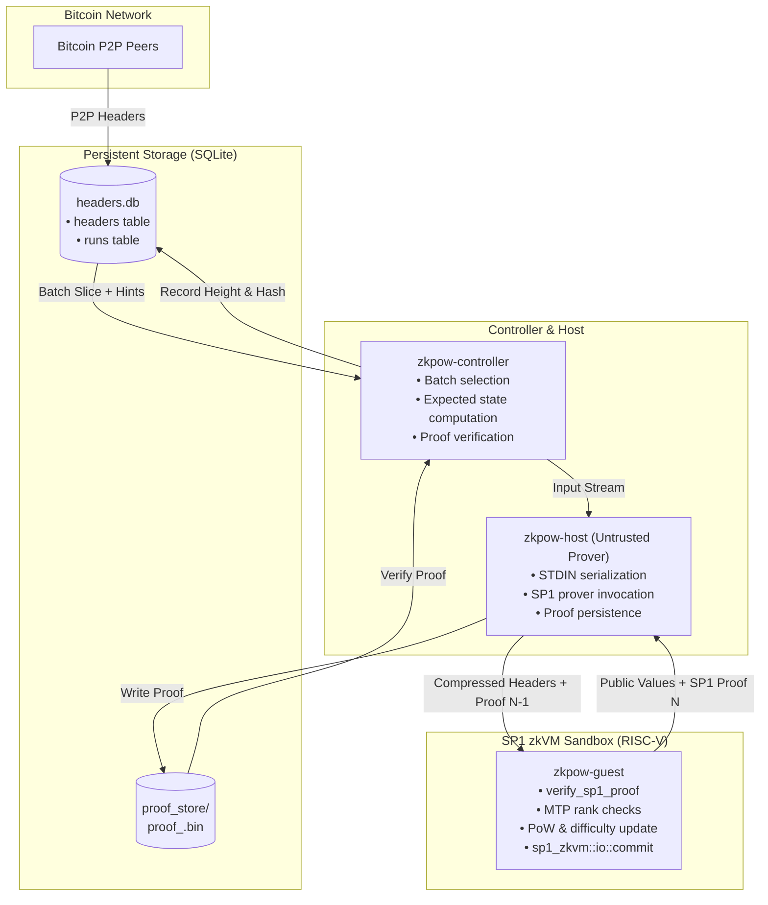

# Architecture: zkpow

## 1. System Topology and Trust Boundaries

zkpow divides work across four distinct architectural tiers:

### Trust Boundary Model

| Tier | Component | Trust Level | Invariants Enforced |
| :--- | :--- | :--- | :--- |
| **Network** | `zkpow-sync-headers` | Untrusted | Validates raw P2P headers, computes cumulative work and MTP run lengths prior to writing to SQLite. |
| **Coordinator** | `zkpow-controller` | Trusted Host-side | Never trusts the host prover. Independently calculates expected public values and runs cryptographic SP1 verification on returned proofs before committing. |
| **Pipeline** | `zkpow-host` | Untrusted | Pure execution pipe. Forwards serialized inputs to SP1 and writes proof bytes. Cannot forge or tamper with state transitions without invalidating the zkVM proof. |
| **Prover Sandbox**| `zkpow-guest` | Trusted Core | Minimal RISC-V program executing inside SP1 zkVM. Cryptographically attests to state correctness from genesis to tip. Rejects invalid hints or mismatched recursive proofs. |

---

## 2. Component Architecture

### 2.1 Bitcoin Header Synchronizer (`crates/sync-headers`)
Connects to Bitcoin P2P peers, performs initial syntactic validation of block headers, and stores them in SQLite (`headers.db`). For each header, it precomputes:
- Cumulative chain work.
- Median Time Past (MTP) over the previous 11 blocks.
- Timestamp ordering metrics (identifying non-decreasing runs to generate sparse median hints).

### 2.2 Storage Engine & Ledger (`crates/store`)
Encapsulates SQLite access through `rusqlite`:
- `headers`: Stores height, block hash, 80-byte raw header, cumulative work, MTP, and median hint indicators.
- `runs`: Maintains execution state per `ZKPOW_RUN_ID` (verified height, last verified block hash, proof file paths, and verifier key digest). Enables crash-resilient restarts.

### 2.3 The Controller (`crates/controller`)
The orchestrator managing batch assignments and verification:
- Evaluates the current tip against the target batch size (2,016, 4,032, or 8,064 headers).
- Precomputes expected `State` and serializes the expected 185-byte public values commitment.
- Issues work units containing compressed header streams, median hints, and witness proofs from height $N-1$.
- Upon proof delivery, executes `sp1_sdk::ProverClient::verify`, checks public values match bit-for-bit, and advances the run ledger.

### 2.4 The Host Prover (`crates/host`)
A stateless runner interfacing with SP1:
- Consumes batches from the controller.
- Writes witness materials to guest standard input.
- Invokes SP1 CUDA/CPU prover to produce compressed recursive proofs.
- Persists proof artifacts to `proof_store/<run_id>/proof_<height>.bin`.

### 2.5 The Guest Program (`crates/guest`)
The deterministic RISC-V program proved by SP1:
- **Proof Recursion:** Reads proof witness $N-1$, hashes expected public values, and invokes `verify_sp1_proof`.
- **Header Processing:** Applies headers in epoch-delimited segments, executing PoW and MTP checks.
- **Commitment:** Emits final `State`, guest `verifier_key`, and return code to public values.

---

## 3. Zero-Knowledge Optimizations

### 3.1 Median Time Past Without In-Guest Sorting
Sorting 11 integers for every block header introduces significant zkVM cycle overhead. zkpow resolves medians using two paths:
1. **Ordered Run Fast-Path:** When the previous 11 block timestamps are monotonically non-decreasing, the median is selected from a static slot using a compile-time lookup table indexed by `height % 11`.
2. **Sparse Hint Rank-Check:** When timestamp disorder occurs, the controller provides a median hint. The guest performs a linear scan counting elements less than and greater than the hint. If the hint does not occupy median rank (rank 5), the guest halts immediately.

### 3.2 Unconstrained Quotient with Multiplication Check
Bitcoin difficulty retargeting requires 256-bit integer division:
$$\text{work} = \left\lfloor \frac{2^{256}}{\text{target} + 1} \right\rfloor$$
Executing 256-bit division inside the zkVM circuit is costly. The guest executes the division unconstrained and verifies the quotient $q$ and remainder $r$ with a single 256-bit multiplication syscall:
$$2^{256} = q \times (\text{target} + 1) + r, \quad 0 \le r \le \text{target}$$

### 3.3 Epoch Segment Batching
Difficulty and work per block remain constant throughout each 2,016-block epoch. The guest processes batches in segments split by epoch boundaries:
- Calculates compact target, work per block, and boundary conditions once per segment.
- Accumulates chain work across the entire segment in a single scalar addition: $\text{work} \times \text{count}$.

---

## 4. Fault Tolerance and Recovery

- **Deterministic Resume:** Every completed batch commits transactionally to `runs` in `headers.db`. A process restarted with `ZKPOW_RUN_ID` picks up immediately from the last verified height and loads the corresponding proof witness from `proof_store/`.
- **Batch Lease & Heartbeat Protocol:** Controller leases prevent duplicate execution; unacknowledged batches expire and are reassigned.
- **Offsite Synchronization:** Proof artifacts and SQLite snapshots synchronize to Backblaze B2 S3 storage, enabling hot-standby nodes to resume proving without reprocessing historical epochs.
