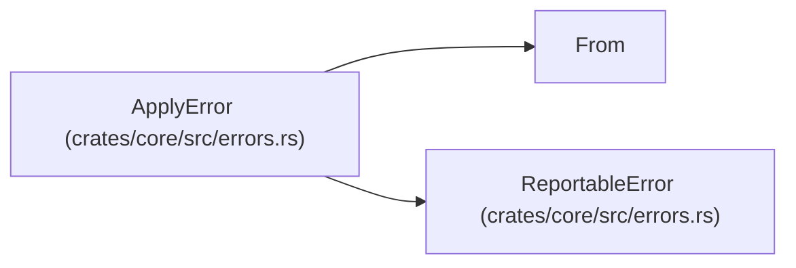

# ApplyError

**Location:** `crates/core/src/errors.rs:46`
**Kind:** Enum
**Bases:** `From`, `ReportableError`
**Module:** [core_src_errors](../modules/core_src_errors.md)

**Decorators:** `@Debug`, `@Clone`, `@Copy`, `@PartialEq`, `@Eq`, `@thiserror::Error`

## Description

Applying headers to a `State` (`crate::State`).

Every variant is a consensus rejection of a specific header, so every variant maps to an
[`ErrorCode`]. Prover hints are not validated here: a bad hint halts with the invalid-hint exit
code rather than returning, so it never becomes an `ApplyError`.

## Attributes

| Name | Declared value | Description |
|------|-------|-------------|
| `TimestampTooOld` | — | — |
| `PowInsufficient` | — | — |
| `InsufficientColdHeaders` | — | — |

## Methods

| Method | Signature | Decorators | Description |
|--------|-----------|------------|-------------|
| `from` | `(error: zkpow_mtp::errors::InsufficientColdHeaders) -> Self` | — | — |
| `error_code` | `() -> Option<ErrorCode >` | — | — |

## Relationships

<!-- Auto-generated relationship summary. Do not edit by hand. -->

### Summary

| Module | Methods | Attributes |
|---|---:|---|
| [core_src_errors](../modules/core_src_errors.md) | 2 | `InsufficientColdHeaders`, `PowInsufficient`, `TimestampTooOld` |

### Structure

| Kind | Entity | Module |
|---|---|---|
| Base | `From` | — |
| Base | `ReportableError` | [core_src_errors](../modules/core_src_errors.md) |
