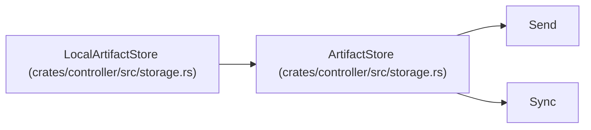

# ArtifactStore

**Location:** `crates/controller/src/storage.rs:7`
**Kind:** Class
**Bases:** `Send`, `Sync`
**Module:** [src_storage](../modules/src_storage.md)

## Description

_Auto-generated from `ArtifactStore` in `crates/controller/src/storage.rs`._

## Attributes

*No annotated attributes found.*

## Methods

| Method | Signature | Decorators | Description |
|--------|-----------|------------|-------------|
| `put_target` | `(run_id: &str, object: &str) -> Result<String, BoxError >` | — | Target the host should upload `object` to. |
| `get_target` | `(run_id: &str, object: &str) -> Result<String, BoxError >` | — | Target the host should download `object` from. |
| `fetch` | `(run_id: &str, object: &str) -> Result<Vec<u8>, BoxError >` | — | Read `object` back on the controller side for completion verification. |

## Relationships

<!-- Auto-generated relationship summary. Do not edit by hand. -->

### Summary

| Module | Methods | Attributes |
|---|---:|---|
| [src_storage](../modules/src_storage.md) | 3 | — |

### Structure

| Kind | Entity | Module |
|---|---|---|
| Base | `Send` | — |
| Base | `Sync` | — |
| Subclass | `LocalArtifactStore` | [src_storage](../modules/src_storage.md) |
