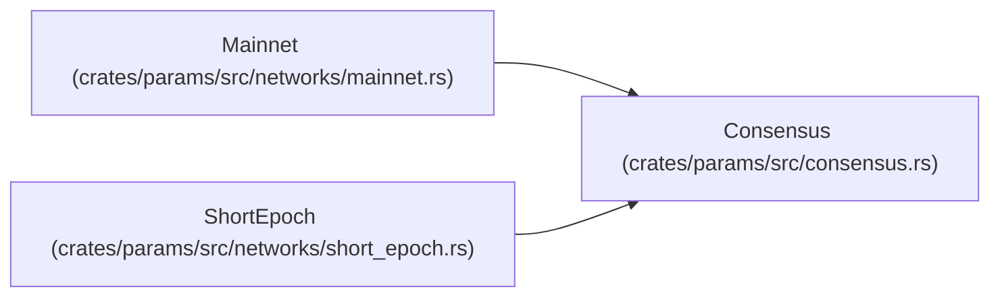

# Consensus

**Location:** `crates/params/src/consensus.rs:77`
**Kind:** Class
**Bases:** —
**Module:** [consensus](../modules/consensus.md)

## Description

Binds one parameter set to a type, so consensus code can be generic over the network and still
read every parameter as a compile-time constant.

## Attributes

*No annotated attributes found.*

## Methods

*No public methods. Inherits from base classes.*

## Relationships

<!-- Auto-generated relationship summary. Do not edit by hand. -->

### Summary

| Module | Methods | Attributes |
|---|---:|---|
| [consensus](../modules/consensus.md) | 0 | — |

### Structure

| Kind | Entity | Module |
|---|---|---|
| Subclass | `Mainnet` | [mainnet](../modules/mainnet.md) |
| Subclass | `ShortEpoch` | [short_epoch](../modules/short_epoch.md) |
