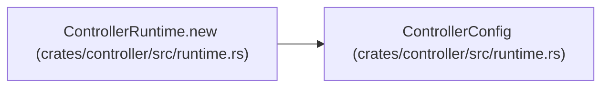

# ControllerConfig

**Location:** `crates/controller/src/runtime.rs:31`
**Kind:** Class
**Bases:** —
**Module:** [src_runtime](../modules/src_runtime.md)

**Decorators:** `@Debug`, `@Clone`

## Description

_Auto-generated from `ControllerConfig` in `crates/controller/src/runtime.rs`._

## Attributes

| Name | Type | Default | Description |
|------|------|---------|-------------|
| `genesis_hash` | `BlockHash` | *required* | — |
| `batch_size` | `u32` | *required* | — |
| `pull_timeout` | `Duration` | *required* | — |

## Methods

| Method | Signature | Decorators | Description |
|--------|-----------|------------|-------------|
| `new` | `(genesis_hash: BlockHash, batch_size: u32) -> Self` | — | — |

## Relationships

<!-- Auto-generated relationship summary. Do not edit by hand. -->

### Summary

| Module | Methods | Attributes |
|---|---:|---|
| [src_runtime](../modules/src_runtime.md) | 1 | `batch_size`, `genesis_hash`, `pull_timeout` |

### References

| Reference | Kind | Source | Call sites |
|---|---|---|---:|
| `ControllerRuntime.new` | type_reference | [src_runtime](../modules/src_runtime.md) | — |
