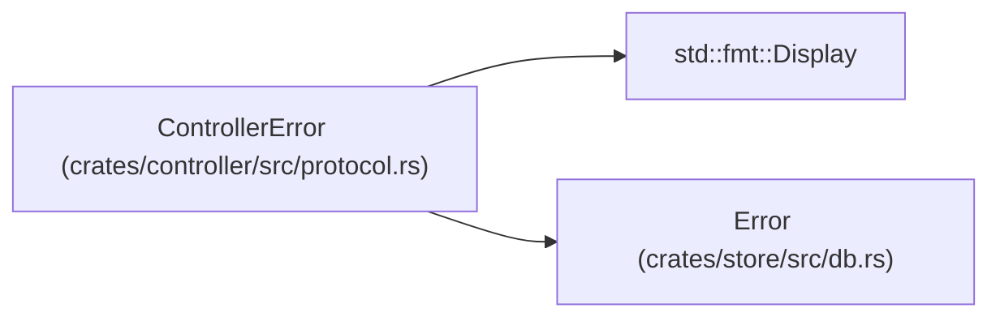

# ControllerError

**Location:** `crates/controller/src/protocol.rs:27`
**Kind:** Class
**Bases:** `std::fmt::Display`, `std::error::Error`
**Module:** [src_protocol](../modules/src_protocol.md)

**Decorators:** `@Debug`, `@Clone`, `@PartialEq`, `@Eq`

## Description

_Auto-generated from `ControllerError` in `crates/controller/src/protocol.rs`._

## Attributes

| Name | Type | Default | Description |
|------|------|---------|-------------|
| `kind` | `ErrorKind` | *required* | — |
| `message` | `String` | *required* | — |

## Methods

| Method | Signature | Decorators | Description |
|--------|-----------|------------|-------------|
| `bad_request` | `(message: impl Into<String >) -> Self` | — | — |
| `exhausted` | `(message: impl Into<String >) -> Self` | — | — |
| `conflict` | `(message: impl Into<String >) -> Self` | — | — |
| `timeout` | `(message: impl Into<String >) -> Self` | — | — |
| `internal` | `(message: impl Into<String >) -> Self` | — | — |
| `fmt` | `(f: &mut std::fmt::Formatter<'_ >) -> std::fmt::Result` | — | — |

## Relationships

<!-- Auto-generated relationship summary. Do not edit by hand. -->

### Summary

| Module | Methods | Attributes |
|---|---:|---|
| [src_protocol](../modules/src_protocol.md) | 6 | `kind`, `message` |

### Structure

| Kind | Entity | Module |
|---|---|---|
| Base | `std::fmt::Display` | — |
| Base | `Error` | [src_db](../modules/src_db.md) |
