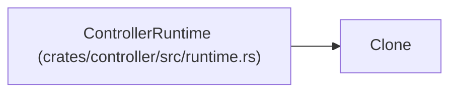

# ControllerRuntime

**Location:** `crates/controller/src/runtime.rs:118`
**Kind:** Class
**Bases:** `Clone`
**Module:** [src_runtime](../modules/src_runtime.md)

## Description

The controller handle. Clones share one core.

## Attributes

| Name | Type | Default | Description |
|------|------|---------|-------------|
| `inner` | `Arc<RuntimeInner<C>>` | *required* | — |

## Methods

| Method | Signature | Decorators | Description |
|--------|-----------|------------|-------------|
| `clone` | `() -> Self` | — | — |
| `new` | `(store: HeaderStore, storage: Box<dyn ArtifactStore >, verifier: Box<dyn ProofVerifier >, config: ControllerConfig) -> Self` | — | — |
| `pull_batch` | *(async)* `(run_id: &str) -> Result<Batch, ControllerError >` | — | The next batch grant for `run_id`. At most one batch is outstanding per run, so this waits |
| `complete` | *(async)* `(run_id: &str) -> Result<(), ControllerError >` | — | Verify the pending batch's uploaded proof and persist the new verified height. A |

## Relationships

<!-- Auto-generated relationship summary. Do not edit by hand. -->

### Summary

| Module | Methods | Attributes |
|---|---:|---|
| [src_runtime](../modules/src_runtime.md) | 4 | `inner` |

### Structure

| Kind | Entity | Module |
|---|---|---|
| Base | `Clone` | — |
