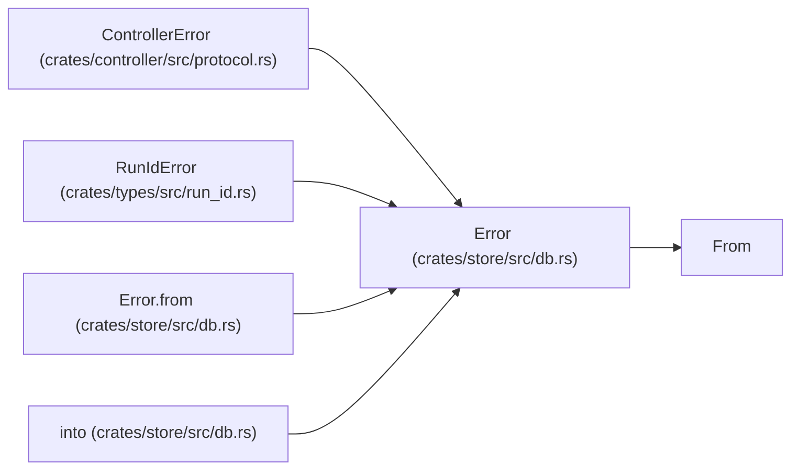

# Error

**Location:** `crates/store/src/db.rs:18`
**Kind:** Enum
**Bases:** `From`
**Module:** [src_db](../modules/src_db.md)

**Decorators:** `@thiserror::Error`, `@Debug`

## Description

Failures from `headers.db` access: a column of the wrong width, a `rusqlite` error, or a failed `bytemuck` cast. Converts into `rusqlite::Error` so it can be returned from row-mapping closures.

## Attributes

| Name | Declared value | Description |
|------|-------|-------------|
| `ConversionError` | — | — |
| `RusqliteError` | — | — |
| `BytemuckDeserializeError` | — | — |

## Methods

| Method | Signature | Decorators | Description |
|--------|-----------|------------|-------------|
| `from` | `(err: Error) -> Self` | — | — |

## Relationships

<!-- Auto-generated relationship summary. Do not edit by hand. -->

### Summary

| Module | Methods | Attributes |
|---|---:|---|
| [src_db](../modules/src_db.md) | 1 | `BytemuckDeserializeError`, `ConversionError`, `RusqliteError` |

### Structure

| Kind | Entity | Module |
|---|---|---|
| Base | `From` | — |
| Subclass | `ControllerError` | [src_protocol](../modules/src_protocol.md) |
| Subclass | `RunIdError` | [src_run_id](../modules/src_run_id.md) |

### References

| Reference | Kind | Source | Call sites |
|---|---|---|---:|
| `Error.from` | type_reference | [src_db](../modules/src_db.md) | — |
| `into` | type_reference | [src_db](../modules/src_db.md) | — |
