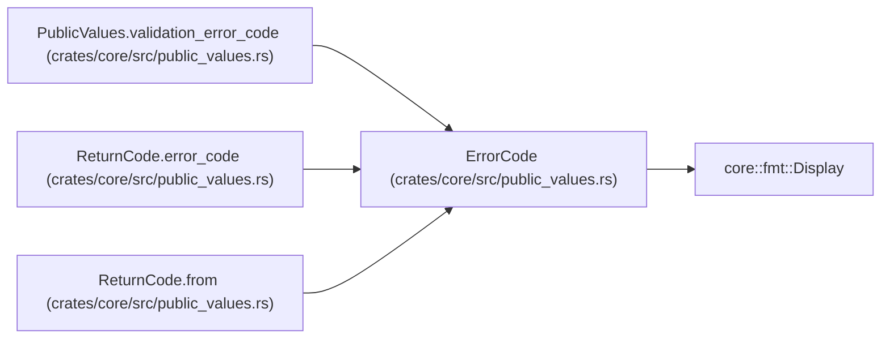

# ErrorCode

**Location:** `crates/core/src/public_values.rs:61`
**Kind:** Class
**Bases:** `core::fmt::Display`
**Module:** [public_values](../modules/public_values.md)

**Decorators:** `@Debug`, `@Clone`, `@Copy`, `@PartialEq`, `@Eq`

## Description

The non-zero exit status the guest commits when validation fails.

Wire-encoded like a Unix exit status: `0` is success, so an `ErrorCode` is always
non-zero. only provides the untyped integer code; `ReportableError` (`crate::ReportableError`)
maps codes to typed values with contextual information.

## Attributes

*No annotated attributes found.*

## Methods

| Method | Signature | Decorators | Description |
|--------|-----------|------------|-------------|
| `new` | `(value: u8) -> Option<Self >` | — | Create an `ErrorCode` from a raw byte, returning `None` for `0`. |
| `get` | `() -> u8` | — | Return the raw byte representation. |
| `name` | `() -> Option<&'static str >` | — | The name of a code the validator defines, or `None` for any other non-zero byte. |
| `fmt` | `(f: &mut core::fmt::Formatter<'_ >) -> core::fmt::Result` | — | — |

## Relationships

<!-- Auto-generated relationship summary. Do not edit by hand. -->

### Summary

| Module | Methods | Attributes |
|---|---:|---|
| [public_values](../modules/public_values.md) | 4 | — |

### Structure

| Kind | Entity | Module |
|---|---|---|
| Base | `core::fmt::Display` | — |

### References

| Reference | Kind | Source | Call sites |
|---|---|---|---:|
| `PublicValues.validation_error_code` | type_reference | [public_values](../modules/public_values.md) | — |
| `ReturnCode.error_code` | type_reference | [public_values](../modules/public_values.md) | — |
| `ReturnCode.from` | type_reference | [public_values](../modules/public_values.md) | — |
