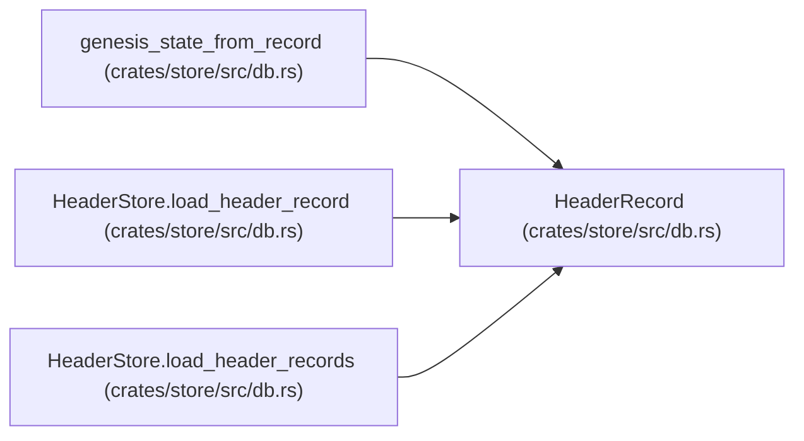

# HeaderRecord

**Location:** `crates/store/src/db.rs:530`
**Kind:** Class
**Bases:** —
**Module:** [src_db](../modules/src_db.md)

**Decorators:** `@Debug`, `@Clone`

## Description

A single `headers` row, decoded into typed fields.

## Attributes

| Name | Type | Default | Description |
|------|------|---------|-------------|
| `height` | `u64` | *required* | — |
| `header` | `Header` | *required* | — |
| `chain_work` | `ChainWork` | *required* | — |
| `median_time_past` | `BlockTimestamp` | *required* | — |
| `ordered_timestamp_run` | `u64` | *required* | — |

## Methods

*No public methods. Inherits from base classes.*

## Relationships

<!-- Auto-generated relationship summary. Do not edit by hand. -->

### Summary

| Module | Methods | Attributes |
|---|---:|---|
| [src_db](../modules/src_db.md) | 0 | `chain_work`, `header`, `height`, `median_time_past`, `ordered_timestamp_run` |

### References

| Reference | Kind | Source | Call sites |
|---|---|---|---:|
| `genesis_state_from_record` | type_reference | [src_db](../modules/src_db.md) | — |
| `HeaderStore.load_header_record` | type_reference | [src_db](../modules/src_db.md) | — |
| `HeaderStore.load_header_records` | type_reference | [src_db](../modules/src_db.md) | — |
