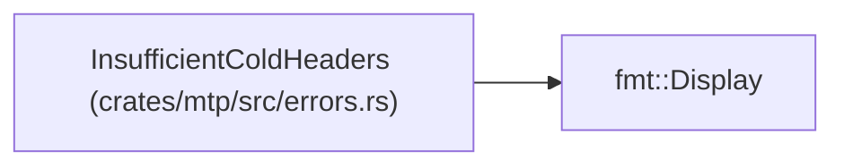

# InsufficientColdHeaders

**Location:** `crates/mtp/src/errors.rs:29`
**Kind:** Class
**Bases:** `fmt::Display`
**Module:** [mtp_src_errors](../modules/mtp_src_errors.md)

**Decorators:** `@Debug`, `@Clone`, `@Copy`, `@PartialEq`, `@Eq`

## Description

Why a header slice cannot be split into the cold prefix and warm remainder.

## Attributes

| Name | Type | Default | Description |
|------|------|---------|-------------|
| `required` | `usize` | *required* | — |
| `actual` | `usize` | *required* | — |

## Methods

| Method | Signature | Decorators | Description |
|--------|-----------|------------|-------------|
| `required` | `() -> usize` | — | — |
| `actual` | `() -> usize` | — | — |
| `fmt` | `(f: &mut fmt::Formatter<'_ >) -> fmt::Result` | — | — |

## Relationships

<!-- Auto-generated relationship summary. Do not edit by hand. -->

### Summary

| Module | Methods | Attributes |
|---|---:|---|
| [mtp_src_errors](../modules/mtp_src_errors.md) | 3 | `actual`, `required` |

### Structure

| Kind | Entity | Module |
|---|---|---|
| Base | `fmt::Display` | — |
