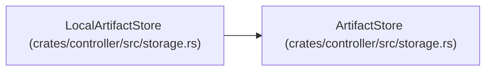

# LocalArtifactStore

**Location:** `crates/controller/src/storage.rs:14`
**Kind:** Class
**Bases:** `ArtifactStore`
**Module:** [src_storage](../modules/src_storage.md)

## Description

_Auto-generated from `LocalArtifactStore` in `crates/controller/src/storage.rs`._

## Attributes

| Name | Type | Default | Description |
|------|------|---------|-------------|
| `root` | `PathBuf` | *required* | — |

## Methods

| Method | Signature | Decorators | Description |
|--------|-----------|------------|-------------|
| `new` | `(root: impl Into<PathBuf >) -> Self` | — | — |
| `put_target` | `(run_id: &str, object: &str) -> Result<String, BoxError >` | — | — |
| `get_target` | `(run_id: &str, object: &str) -> Result<String, BoxError >` | — | — |
| `fetch` | `(run_id: &str, object: &str) -> Result<Vec<u8>, BoxError >` | — | — |

## Relationships

<!-- Auto-generated relationship summary. Do not edit by hand. -->

### Summary

| Module | Methods | Attributes |
|---|---:|---|
| [src_storage](../modules/src_storage.md) | 4 | `root` |

### Structure

| Kind | Entity | Module |
|---|---|---|
| Base | `ArtifactStore` | [src_storage](../modules/src_storage.md) |
