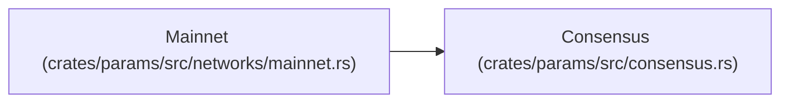

# Mainnet

**Location:** `crates/params/src/networks/mainnet.rs:5`
**Kind:** Class
**Bases:** `Consensus`
**Module:** [mainnet](../modules/mainnet.md)

## Description

Bitcoin mainnet.

## Attributes

*No annotated attributes found.*

## Methods

*No public methods. Inherits from base classes.*

## Relationships

<!-- Auto-generated relationship summary. Do not edit by hand. -->

### Summary

| Module | Methods | Attributes |
|---|---:|---|
| [mainnet](../modules/mainnet.md) | 0 | — |

### Structure

| Kind | Entity | Module |
|---|---|---|
| Base | `Consensus` | [consensus](../modules/consensus.md) |
