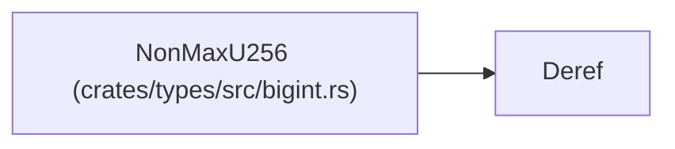

# NonMaxU256

**Location:** `crates/types/src/bigint.rs:166`
**Kind:** Class
**Bases:** `Deref`
**Module:** [src_bigint](../modules/src_bigint.md)

**Decorators:** `@Clone`, `@Copy`, `@Debug`, `@Default`, `@Eq`, `@PartialEq`, `@PartialOrd`, `@Ord`

## Description

A [`u256`] excluding the all-ones maximum.

Block work is `2^256 / (target + 1)`, so a target must survive `+ 1` without wrapping. Storing
it as `NonMaxU256` makes that a type guarantee instead of a runtime check.

## Attributes

*No annotated attributes found.*

## Methods

| Method | Signature | Decorators | Description |
|--------|-----------|------------|-------------|
| `new` | `(value: u256) -> Option<Self >` | — | Construct a value unless every limb is saturated. |
| `from_limbs` | `(limbs: [u64 ; 4]) -> Self` | — | [`NonMaxU256::new`] from limbs. Panics when every limb is `u64::MAX`. |
| `try_from_limbs` | `(limbs: [u64 ; 4]) -> Option<Self >` | — | — |
| `into_inner` | `() -> u256` | — | — |
| `as_inner` | `() -> &u256` | — | — |
| `as_inner_mut` | `() -> &mut u256` | — | — |
| `deref` | `() -> &Self::Target` | — | — |

## Relationships

<!-- Auto-generated relationship summary. Do not edit by hand. -->

### Summary

| Module | Methods | Attributes |
|---|---:|---|
| [src_bigint](../modules/src_bigint.md) | 7 | — |

### Structure

| Kind | Entity | Module |
|---|---|---|
| Base | `Deref` | — |
