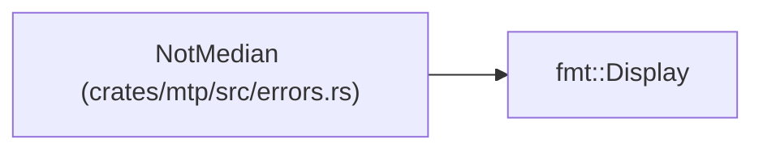

# NotMedian

**Location:** `crates/mtp/src/errors.rs:5`
**Kind:** Enum
**Bases:** `fmt::Display`
**Module:** [mtp_src_errors](../modules/mtp_src_errors.md)

**Decorators:** `@Debug`, `@Clone`, `@Copy`, `@PartialEq`, `@Eq`

## Description

Why a claimed median is not the window's median.

## Attributes

| Name | Declared value | Description |
|------|-------|-------------|
| `TooNew` | — | — |
| `TooOld` | — | — |

## Methods

| Method | Signature | Decorators | Description |
|--------|-----------|------------|-------------|
| `fmt` | `(f: &mut fmt::Formatter<'_ >) -> fmt::Result` | — | — |

## Relationships

<!-- Auto-generated relationship summary. Do not edit by hand. -->

### Summary

| Module | Methods | Attributes |
|---|---:|---|
| [mtp_src_errors](../modules/mtp_src_errors.md) | 1 | `TooNew`, `TooOld` |

### Structure

| Kind | Entity | Module |
|---|---|---|
| Base | `fmt::Display` | — |
