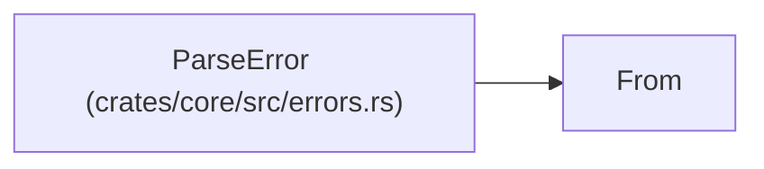

# ParseError

**Location:** `crates/core/src/errors.rs:19`
**Kind:** Enum
**Bases:** `From`
**Module:** [core_src_errors](../modules/core_src_errors.md)

**Decorators:** `@Debug`, `@Clone`, `@Copy`, `@PartialEq`, `@Eq`, `@thiserror::Error`

## Description

Reading a fixed-width wire encoding out of a byte slice.

## Attributes

| Name | Declared value | Description |
|------|-------|-------------|
| `InvalidLength` | — | — |
| `Misaligned` | — | — |
| `Truncated` | — | — |
| `PodCastError` | — | — |

## Methods

| Method | Signature | Decorators | Description |
|--------|-----------|------------|-------------|
| `from` | `(value: PodCastError) -> Self` | — | — |

## Relationships

<!-- Auto-generated relationship summary. Do not edit by hand. -->

### Summary

| Module | Methods | Attributes |
|---|---:|---|
| [core_src_errors](../modules/core_src_errors.md) | 1 | `InvalidLength`, `Misaligned`, `PodCastError`, `Truncated` |

### Structure

| Kind | Entity | Module |
|---|---|---|
| Base | `From` | — |
