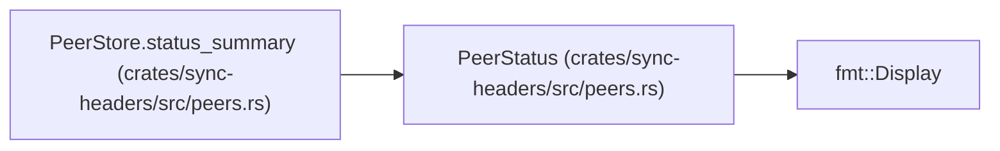

# PeerStatus

**Location:** `crates/sync-headers/src/peers.rs:29`
**Kind:** Enum
**Bases:** `fmt::Display`
**Module:** [src_peers](../modules/src_peers.md)

**Decorators:** `@Debug`, `@Clone`, `@Copy`, `@PartialEq`, `@Eq`, `@Hash`

## Description

Lifecycle status of a known peer address.

## Attributes

| Name | Declared value | Description |
|------|-------|-------------|
| `Unknown` | — | — |
| `Connected` | — | — |
| `Unreachable` | — | — |
| `Disconnected` | — | — |
| `TooSlow` | — | — |

## Methods

| Method | Signature | Decorators | Description |
|--------|-----------|------------|-------------|
| `fmt` | `(f: &mut fmt::Formatter<'_ >) -> fmt::Result` | — | — |

## Relationships

<!-- Auto-generated relationship summary. Do not edit by hand. -->

### Summary

| Module | Methods | Attributes |
|---|---:|---|
| [src_peers](../modules/src_peers.md) | 1 | `Connected`, `Disconnected`, `TooSlow`, `Unknown`, `Unreachable` |

### Structure

| Kind | Entity | Module |
|---|---|---|
| Base | `fmt::Display` | — |

### References

| Reference | Kind | Source | Call sites |
|---|---|---|---:|
| `PeerStore.status_summary` | type_reference | [src_peers](../modules/src_peers.md) | — |
