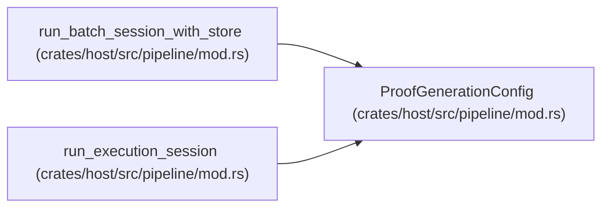

# ProofGenerationConfig

**Location:** `crates/host/src/pipeline/mod.rs:55`
**Kind:** Class
**Bases:** —
**Module:** [host_src_pipeline_mod](../modules/host_src_pipeline_mod.md)

**Decorators:** `@Debug`, `@Clone`

## Description

One proving session's settings, read from `ZKPOW_*` variables by [`input::config_from_env`].

## Attributes

| Name | Type | Default | Description |
|------|------|---------|-------------|
| `run_id` | `String` | *required* | — |
| `local_batch_size` | `u32` | *required* | — |
| `batch_count` | `u32` | *required* | — |
| `db_path` | `std::path::PathBuf` | *required* | — |
| `execute_only` | `bool` | *required* | — |
| `prover_backend` | `ProverBackend` | *required* | — |

## Methods

*No public methods. Inherits from base classes.*

## Relationships

<!-- Auto-generated relationship summary. Do not edit by hand. -->

### Summary

| Module | Methods | Attributes |
|---|---:|---|
| [host_src_pipeline_mod](../modules/host_src_pipeline_mod.md) | 0 | `batch_count`, `db_path`, `execute_only`, `local_batch_size`, `prover_backend`, `run_id` |

### References

| Reference | Kind | Source | Call sites |
|---|---|---|---:|
| `run_batch_session_with_store` | type_reference | [host_src_pipeline_mod](../modules/host_src_pipeline_mod.md) | — |
| `run_execution_session` | type_reference | [host_src_pipeline_mod](../modules/host_src_pipeline_mod.md) | — |
