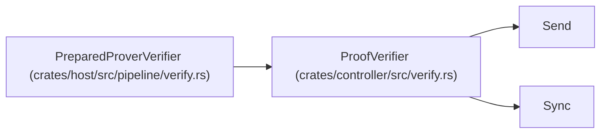

# ProofVerifier

**Location:** `crates/controller/src/verify.rs:9`
**Kind:** Class
**Bases:** `Send`, `Sync`
**Module:** [src_verify](../modules/src_verify.md)

## Description

_Auto-generated from `ProofVerifier` in `crates/controller/src/verify.rs`._

## Attributes

*No annotated attributes found.*

## Methods

| Method | Signature | Decorators | Description |
|--------|-----------|------------|-------------|
| `verifier_key_digest` | `() -> zkpow_core::VerifierKeyDigest` | — | — |
| `verify_compressed` | `(proof_bytes: &[u8], expected_public_values: &[u8]) -> Result<(), String >` | — | Cryptographically verify a compressed proof artifact. The proof's |

## Relationships

<!-- Auto-generated relationship summary. Do not edit by hand. -->

### Summary

| Module | Methods | Attributes |
|---|---:|---|
| [src_verify](../modules/src_verify.md) | 2 | — |

### Structure

| Kind | Entity | Module |
|---|---|---|
| Base | `Send` | — |
| Base | `Sync` | — |
| Subclass | `PreparedProverVerifier` | [pipeline_verify](../modules/pipeline_verify.md) |
