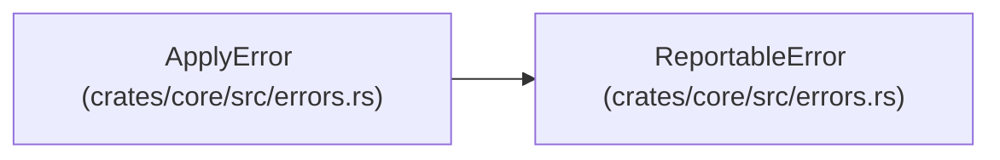

# ReportableError

**Location:** `crates/core/src/errors.rs:6`
**Kind:** Class
**Bases:** —
**Module:** [core_src_errors](../modules/core_src_errors.md)

## Description

An error that can end the guest program. Transforms typed errors into [`ErrorCode`]s.

## Attributes

*No annotated attributes found.*

## Methods

| Method | Signature | Decorators | Description |
|--------|-----------|------------|-------------|
| `error_code` | `() -> Option<ErrorCode >` | — | The code committed for this error, or `None` when the error has no code of its own. |
| `return_code` | `() -> ReturnCode` | — | The return code the guest commits for this error. An error with no code of its own still |

## Relationships

<!-- Auto-generated relationship summary. Do not edit by hand. -->

### Summary

| Module | Methods | Attributes |
|---|---:|---|
| [core_src_errors](../modules/core_src_errors.md) | 2 | — |

### Structure

| Kind | Entity | Module |
|---|---|---|
| Subclass | `ApplyError` | [core_src_errors](../modules/core_src_errors.md) |
