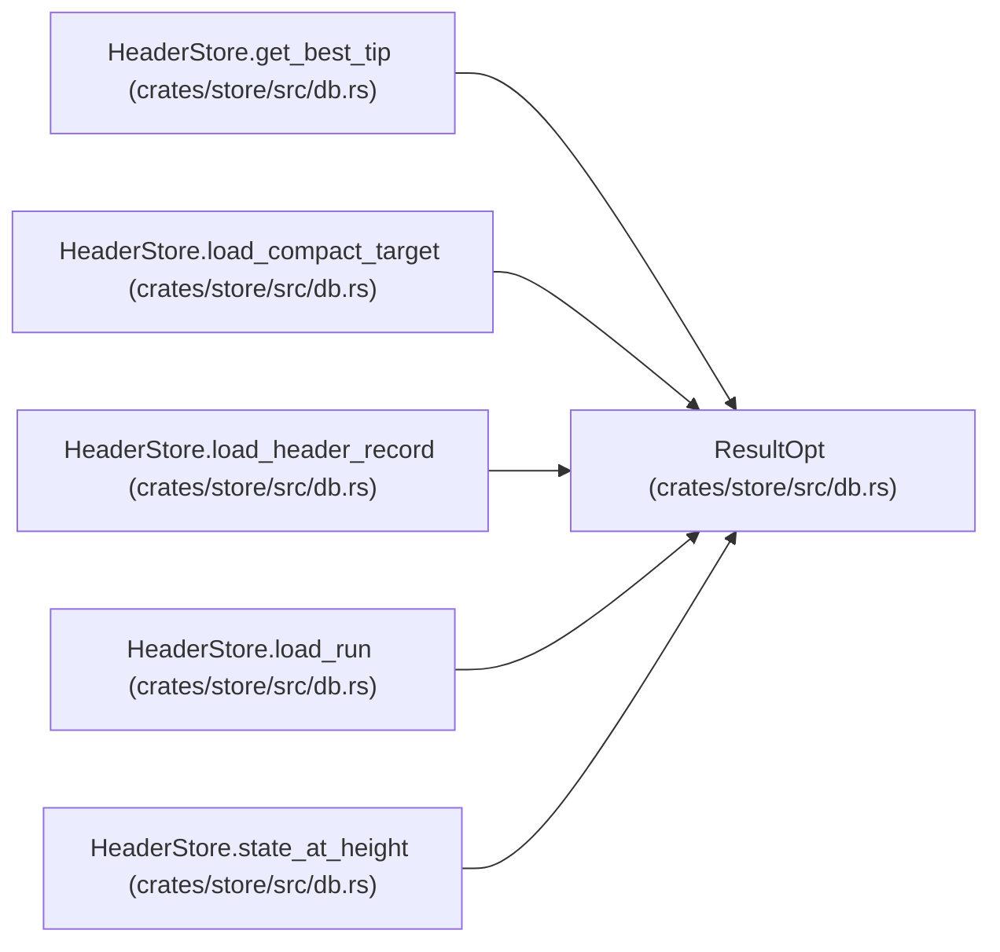

# ResultOpt

**Location:** `crates/store/src/db.rs:46`
**Kind:** Type alias
**Bases:** —
**Module:** [src_db](../modules/src_db.md)

## Description

_Auto-generated from `ResultOpt` in `crates/store/src/db.rs`._

## Attributes

*No annotated attributes found.*

## Methods

*No public methods. Inherits from base classes.*

## Relationships

<!-- Auto-generated relationship summary. Do not edit by hand. -->

### Summary

| Module | Methods | Attributes |
|---|---:|---|
| [src_db](../modules/src_db.md) | 0 | — |

### References

| Reference | Kind | Source | Call sites |
|---|---|---|---:|
| `HeaderStore.get_best_tip` | type_reference | [src_db](../modules/src_db.md) | — |
| `HeaderStore.load_compact_target` | type_reference | [src_db](../modules/src_db.md) | — |
| `HeaderStore.load_header_record` | type_reference | [src_db](../modules/src_db.md) | — |
| `HeaderStore.load_run` | type_reference | [src_db](../modules/src_db.md) | — |
| `HeaderStore.state_at_height` | type_reference | [src_db](../modules/src_db.md) | — |
