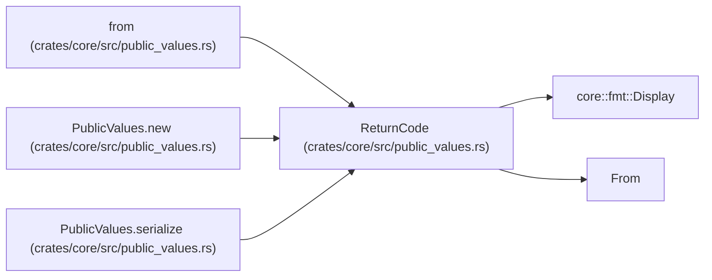

# ReturnCode

**Location:** `crates/core/src/public_values.rs:119`
**Kind:** Class
**Bases:** `From`, `core::fmt::Display`
**Module:** [public_values](../modules/public_values.md)

**Decorators:** `@Debug`, `@Clone`, `@Copy`, `@PartialEq`, `@Eq`, `@Default`

## Description

A validation result: `None` means success, `Some(ErrorCode)` means failure.

Wire representation is a single `u8`: `0` for success, non-zero for failure.
Every `u8` is a valid `ReturnCode`, so conversion from `u8` is infallible.

## Attributes

*No annotated attributes found.*

## Methods

| Method | Signature | Decorators | Description |
|--------|-----------|------------|-------------|
| `new` | `(value: u8) -> Self` | — | Create a `ReturnCode` from a raw byte. `0` is success, any non-zero |
| `is_success` | `() -> bool` | — | Return `true` if this represents success. |
| `is_failure` | `() -> bool` | — | Return `true` if this represents a failure. |
| `error_code` | `() -> Option<ErrorCode >` | — | Return the underlying error code, if any. |
| `into_u8` | `() -> u8` | — | Return the raw byte representation. |
| `from` | `(value: u8) -> Self` | — | — |
| `from` | `(error: ErrorCode) -> Self` | — | — |
| `fmt` | `(f: &mut core::fmt::Formatter<'_ >) -> core::fmt::Result` | — | — |

## Relationships

<!-- Auto-generated relationship summary. Do not edit by hand. -->

### Summary

| Module | Methods | Attributes |
|---|---:|---|
| [public_values](../modules/public_values.md) | 8 | — |

### Structure

| Kind | Entity | Module |
|---|---|---|
| Base | `core::fmt::Display` | — |
| Base | `From` | — |

### References

| Reference | Kind | Source | Call sites |
|---|---|---|---:|
| `from` | type_reference | [public_values](../modules/public_values.md) | — |
| `PublicValues.new` | type_reference | [public_values](../modules/public_values.md) | — |
| `PublicValues.serialize` | type_reference | [public_values](../modules/public_values.md) | — |
