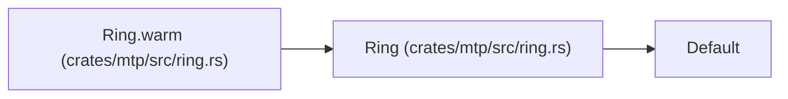

# Ring

**Location:** `crates/mtp/src/ring.rs:22`
**Kind:** Class
**Bases:** `Default`
**Module:** [ring](../modules/ring.md)

**Decorators:** `@Debug`, `@Clone`, `@Copy`, `@PartialEq`, `@Eq`

## Description

The last `N` timestamps, oldest overwritten first. `ordered_run` is the length of the
nondecreasing run ending at the newest value, capped at `N`.

## Attributes

| Name | Type | Default | Description |
|------|------|---------|-------------|
| `values` | `[u32 ; N]` | *required* | — |
| `next` | `usize` | *required* | — |
| `len` | `usize` | *required* | — |
| `ordered_run` | `usize` | *required* | — |
| `last_value` | `u32` | *required* | — |
| `fill` | `PhantomData<F >` | *required* | — |

## Methods

| Method | Signature | Decorators | Description |
|--------|-----------|------------|-------------|
| `len` | `() -> usize` | — | The number of timestamps currently held. |
| `is_empty` | `() -> bool` | — | Whether the ring contains no timestamps. |
| `parts` | `() -> (&[u32 ; N], usize, usize)` | — | Returns the backing slots, next write position, and number of values held. |
| `push` | `(value: u32)` | — | Inserts a timestamp. |
| `new` | `() -> Self` | — | Creates an empty ring. |
| `from_parts` | `(values: [u32 ; N], len: usize) -> Result<Self, InvalidParts >` | — | Rebuilds a cold ring from its first `len` slots in chronological order. |
| `median` | `() -> Option<u32 >` | — | The upper median, or `None` while the ring is empty or holds a decrease. |
| `median_by_sort` | `() -> Option<u32 >` | — | The upper median by sorting a copy of the values held, or `None` while empty. |
| `is_value_median` | `(claimed_median: u32) -> Result<(), NotMedian >` | — | Checks a claimed median by rank. |
| `warm` | `() -> Result<Ring<N, Warm>, InvalidParts >` | — | Converts to a warm ring once every slot holds a timestamp. |
| `default` | `() -> Self` | — | — |
| `from_parts` | `(values: [u32 ; N], next: usize, len: usize) -> Result<Self, InvalidParts >` | — | Rebuilds a warm ring from its slots and next write position, which is also the oldest slot. |
| `push` | `(value: u32)` | — | Inserts a timestamp, overwriting the oldest slot. |
| `newest` | `() -> u32` | — | The most recently pushed timestamp. |
| `median` | `() -> Option<u32 >` | — | The upper median in constant time, or `None` while the window holds a decrease. |
| `is_value_median` | `(claimed_median: u32) -> Result<(), NotMedian >` | — | Checks a claimed median by rank. |

## Relationships

<!-- Auto-generated relationship summary. Do not edit by hand. -->

### Summary

| Module | Methods | Attributes |
|---|---:|---|
| [ring](../modules/ring.md) | 16 | `fill`, `last_value`, `len`, `next`, `ordered_run`, `values` |

### Structure

| Kind | Entity | Module |
|---|---|---|
| Base | `Default` | — |

### References

| Reference | Kind | Source | Call sites |
|---|---|---|---:|
| `Ring.warm` | type_reference | [ring](../modules/ring.md) | — |
