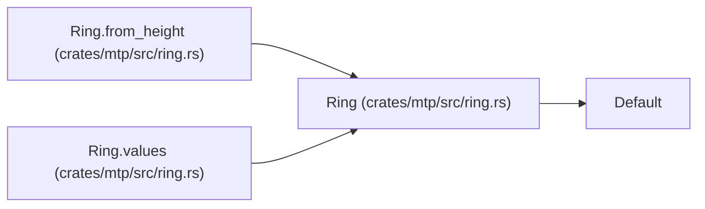

# Ring

**Location:** `crates/mtp/src/ring.rs:15`
**Kind:** Class
**Bases:** `Default`
**Module:** [ring](../modules/ring.md)

**Decorators:** `@Debug`, `@Clone`, `@Copy`, `@PartialEq`, `@Eq`

## Description

The last `N` timestamps, oldest overwritten first. `ordered_run` is the length of the
nondecreasing run ending at the newest value, capped at `N`.

## Attributes

| Name | Type | Default | Description |
|------|------|---------|-------------|
| `values` | `RingValues<N >` | *required* | — |
| `next` | `usize` | *required* | — |
| `len` | `usize` | *required* | — |
| `ordered_run` | `usize` | *required* | — |
| `last_value` | `BlockTimestamp` | *required* | — |

## Methods

| Method | Signature | Decorators | Description |
|--------|-----------|------------|-------------|
| `new` | `() -> Self` | — | Creates an empty ring. |
| `from_height` | `(values: RingValues<N >, height: u32) -> Self` | — | — |
| `from_timestamps` | `(start_height: u32, timestamps: impl IntoIterator<Item = BlockTimestamp >) -> Self` | — | — |
| `push` | `(value: BlockTimestamp)` | — | Inserts a timestamp, overwriting the oldest slot. |
| `values` | `() -> RingValues<N >` | — | — |
| `newest` | `() -> BlockTimestamp` | — | The most recently pushed timestamp. |
| `median` | `() -> Option<BlockTimestamp >` | — | — |
| `median_with_hint` | `(hints: &mut impl Iterator<Item = &'a BlockTimestamp >) -> Result<BlockTimestamp, NotMedian >` | — | — |
| `median_by_sort` | `() -> Option<BlockTimestamp >` | — | The upper median by sorting a copy of the values held, or `None` while empty. |
| `requires_median_hint` | `() -> bool` | — | — |
| `default` | `() -> Self` | — | — |

## Relationships

<!-- Auto-generated relationship summary. Do not edit by hand. -->

### Summary

| Module | Methods | Attributes |
|---|---:|---|
| [ring](../modules/ring.md) | 11 | `last_value`, `len`, `next`, `ordered_run`, `values` |

### Structure

| Kind | Entity | Module |
|---|---|---|
| Base | `Default` | — |

### References

| Reference | Kind | Source | Call sites |
|---|---|---|---:|
| `Ring.from_height` | type_reference | [ring](../modules/ring.md) | — |
| `Ring.values` | type_reference | [ring](../modules/ring.md) | — |
