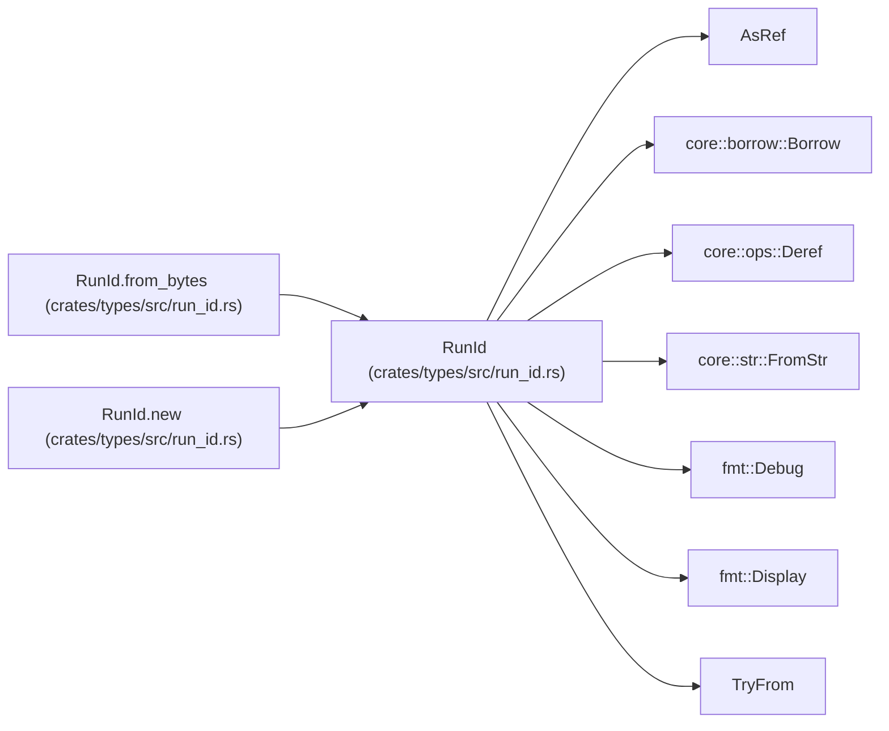

# RunId

**Location:** `crates/types/src/run_id.rs:33`
**Kind:** Class
**Bases:** `core::ops::Deref`, `AsRef`, `core::borrow::Borrow`, `fmt::Display`, `fmt::Debug`, `TryFrom`, `core::str::FromStr`
**Module:** [src_run_id](../modules/src_run_id.md)

**Decorators:** `@Clone`, `@Copy`, `@PartialEq`, `@Eq`, `@PartialOrd`, `@Ord`, `@Hash`

## Description

A strongly-typed 8-byte ASCII alphanumeric identifier for proving runs.

Only ASCII digits (`0..=9`), uppercase letters (`A..=Z`), and lowercase letters (`a..=z`)
are permitted (62^8 ≈ 2.18 × 10^14 possible identifiers).

No symbols, path separators, or Unicode characters are allowed. This guarantees that a
`RunId` is always safe to use as a single path component without escaping or path traversal.

## Attributes

*No annotated attributes found.*

## Methods

| Method | Signature | Decorators | Description |
|--------|-----------|------------|-------------|
| `from_bytes` | `(bytes: [u8 ; 8]) -> Result<Self, RunIdError >` | — | Validates and constructs a [`RunId`] from an owned 8-byte array. |
| `new` | `(bytes: [u8 ; 8]) -> Result<Self, RunIdError >` | — | Alias for `from_bytes` (`Self::from_bytes`). |
| `from_str` | `(s: &str) -> Result<Self, RunIdError >` | — | Validates and constructs a [`RunId`] from a string slice. |
| `to_bytes` | `() -> [u8 ; 8]` | — | Returns the underlying 8-byte array. |
| `as_bytes` | `() -> &[u8 ; 8]` | — | Returns a reference to the underlying 8-byte array. |
| `as_str` | `() -> &str` | — | Returns the run ID as a string slice. |
| `deref` | `() -> &Self::Target` | — | — |
| `as_ref` | `() -> &str` | — | — |
| `as_ref` | `() -> &[u8]` | — | — |
| `borrow` | `() -> &str` | — | — |
| `fmt` | `(f: &mut fmt::Formatter<'_ >) -> fmt::Result` | — | — |
| `fmt` | `(f: &mut fmt::Formatter<'_ >) -> fmt::Result` | — | — |
| `try_from` | `(bytes: [u8 ; 8]) -> Result<Self, Self::Error >` | — | — |
| `try_from` | `(s: &str) -> Result<Self, Self::Error >` | — | — |
| `from_str` | `(s: &str) -> Result<Self, Self::Err >` | — | — |

## Relationships

<!-- Auto-generated relationship summary. Do not edit by hand. -->

### Summary

| Module | Methods | Attributes |
|---|---:|---|
| [src_run_id](../modules/src_run_id.md) | 15 | — |

### Structure

| Kind | Entity | Module |
|---|---|---|
| Base | `AsRef` | — |
| Base | `core::borrow::Borrow` | — |
| Base | `core::ops::Deref` | — |
| Base | `core::str::FromStr` | — |
| Base | `fmt::Debug` | — |
| Base | `fmt::Display` | — |
| Base | `TryFrom` | — |

### References

| Reference | Kind | Source | Call sites |
|---|---|---|---:|
| `RunId.from_bytes` | type_reference | [src_run_id](../modules/src_run_id.md) | — |
| `RunId.new` | type_reference | [src_run_id](../modules/src_run_id.md) | — |
