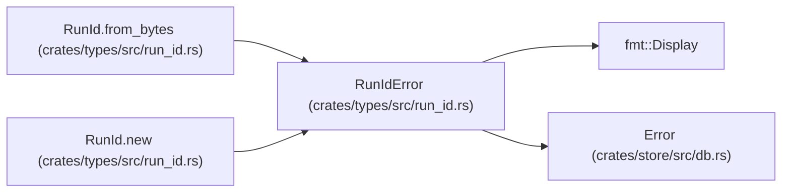

# RunIdError

**Location:** `crates/types/src/run_id.rs:5`
**Kind:** Enum
**Bases:** `fmt::Display`, `core::error::Error`
**Module:** [src_run_id](../modules/src_run_id.md)

**Decorators:** `@Debug`, `@Clone`, `@Copy`, `@PartialEq`, `@Eq`

## Description

An error representing a failed attempt to construct a [`RunId`].

## Attributes

| Name | Declared value | Description |
|------|-------|-------------|
| `InvalidLength` | — | — |
| `InvalidCharacter` | — | — |

## Methods

| Method | Signature | Decorators | Description |
|--------|-----------|------------|-------------|
| `fmt` | `(f: &mut fmt::Formatter<'_ >) -> fmt::Result` | — | — |

## Relationships

<!-- Auto-generated relationship summary. Do not edit by hand. -->

### Summary

| Module | Methods | Attributes |
|---|---:|---|
| [src_run_id](../modules/src_run_id.md) | 1 | `InvalidCharacter`, `InvalidLength` |

### Structure

| Kind | Entity | Module |
|---|---|---|
| Base | `fmt::Display` | — |
| Base | `Error` | [src_db](../modules/src_db.md) |

### References

| Reference | Kind | Source | Call sites |
|---|---|---|---:|
| `RunId.from_bytes` | type_reference | [src_run_id](../modules/src_run_id.md) | — |
| `RunId.new` | type_reference | [src_run_id](../modules/src_run_id.md) | — |
