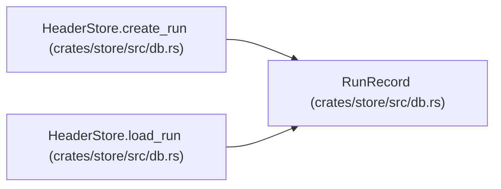

# RunRecord

**Location:** `crates/store/src/db.rs:519`
**Kind:** Class
**Bases:** —
**Module:** [src_db](../modules/src_db.md)

**Decorators:** `@Debug`, `@Clone`, `@PartialEq`, `@Eq`

## Description

One IVC chain's verified progress, keyed by `run_id` in the `runs` table.
Only verified progress is stored; handed-out-but-unverified work is
controller memory and is simply re-issued after a restart.

## Attributes

| Name | Type | Default | Description |
|------|------|---------|-------------|
| `verifier_key` | `VerifierKeyDigest` | *required* | — |
| `verified_height` | `u32` | *required* | — |
| `proof_object` | `Option<String >` | *required* | — |

## Methods

*No public methods. Inherits from base classes.*

## Relationships

<!-- Auto-generated relationship summary. Do not edit by hand. -->

### Summary

| Module | Methods | Attributes |
|---|---:|---|
| [src_db](../modules/src_db.md) | 0 | `proof_object`, `verified_height`, `verifier_key` |

### References

| Reference | Kind | Source | Call sites |
|---|---|---|---:|
| `HeaderStore.create_run` | type_reference | [src_db](../modules/src_db.md) | — |
| `HeaderStore.load_run` | type_reference | [src_db](../modules/src_db.md) | — |
