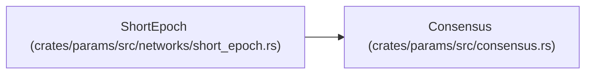

# ShortEpoch

**Location:** `crates/params/src/networks/short_epoch.rs:9`
**Kind:** Class
**Bases:** `Consensus`
**Module:** [short_epoch](../modules/short_epoch.md)

## Description

_Auto-generated from `ShortEpoch` in `crates/params/src/networks/short_epoch.rs`._

## Attributes

*No annotated attributes found.*

## Methods

*No public methods. Inherits from base classes.*

## Relationships

<!-- Auto-generated relationship summary. Do not edit by hand. -->

### Summary

| Module | Methods | Attributes |
|---|---:|---|
| [short_epoch](../modules/short_epoch.md) | 0 | — |

### Structure

| Kind | Entity | Module |
|---|---|---|
| Base | `Consensus` | [consensus](../modules/consensus.md) |
