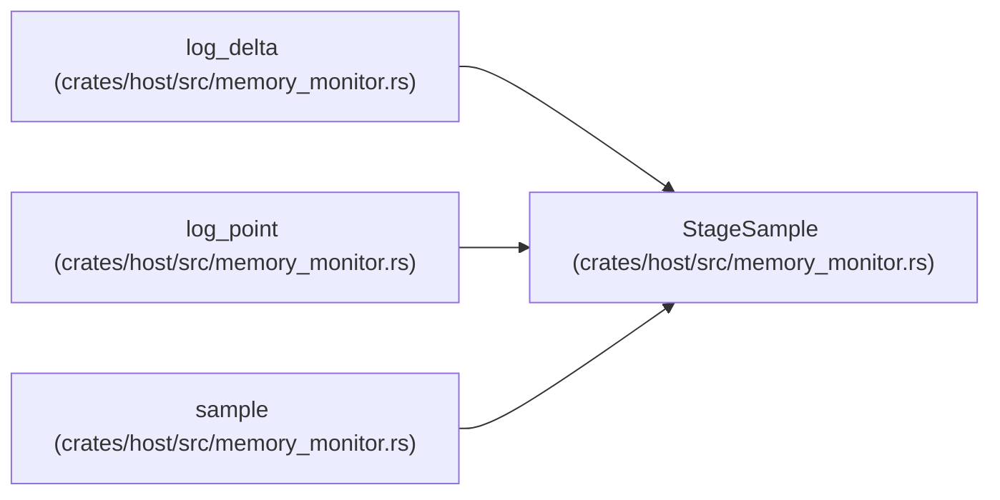

# StageSample

**Location:** `crates/host/src/memory_monitor.rs:14`
**Kind:** Class
**Bases:** —
**Module:** [memory_monitor](../modules/memory_monitor.md)

**Decorators:** `@Debug`, `@Clone`, `@Copy`, `@Default`, `@PartialEq`, `@Eq`

## Description

_Auto-generated from `StageSample` in `crates/host/src/memory_monitor.rs`._

## Attributes

| Name | Type | Default | Description |
|------|------|---------|-------------|
| `rss_kb` | `u64` | *required* | — |
| `live_kb` | `u64` | *required* | — |

## Methods

| Method | Signature | Decorators | Description |
|--------|-----------|------------|-------------|
| `new` | `(rss_kb: u64, live_kb: u64) -> Self` | — | — |
| `rss_kb` | `() -> u64` | — | — |
| `live_kb` | `() -> u64` | — | — |

## Relationships

<!-- Auto-generated relationship summary. Do not edit by hand. -->

### Summary

| Module | Methods | Attributes |
|---|---:|---|
| [memory_monitor](../modules/memory_monitor.md) | 3 | `live_kb`, `rss_kb` |

### References

| Reference | Kind | Source | Call sites |
|---|---|---|---:|
| `log_delta` | type_reference | [memory_monitor](../modules/memory_monitor.md) | — |
| `log_point` | type_reference | [memory_monitor](../modules/memory_monitor.md) | — |
| `sample` | type_reference | [memory_monitor](../modules/memory_monitor.md) | — |
