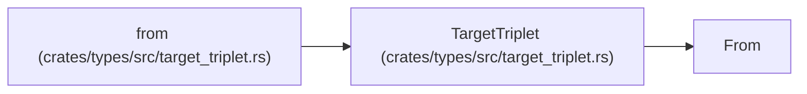

# TargetTriplet

**Location:** `crates/types/src/target_triplet.rs:4`
**Kind:** Class
**Bases:** `From`
**Module:** [target_triplet](../modules/target_triplet.md)

**Decorators:** `@Clone`, `@Copy`, `@Debug`, `@PartialEq`, `@Eq`

## Description

_Auto-generated from `TargetTriplet` in `crates/types/src/target_triplet.rs`._

## Attributes

| Name | Type | Default | Description |
|------|------|---------|-------------|
| `compact_target` | `CompactTarget` | *required* | — |
| `target` | `Target` | *required* | — |
| `block_work` | `BlockWork` | *required* | — |

## Methods

| Method | Signature | Decorators | Description |
|--------|-----------|------------|-------------|
| `new` | `(compact_target: CompactTarget, target: Target, block_work: BlockWork) -> Self` | — | — |
| `compact_target` | `() -> CompactTarget` | — | — |
| `target` | `() -> Target` | — | — |
| `block_work` | `() -> BlockWork` | — | — |
| `components` | `() -> (CompactTarget, Target, BlockWork)` | — | Return the three components as a tuple. |
| `from` | `((compact_target, target, block_work): (CompactTarget, Target, BlockWork)) -> Self` | — | — |

## Relationships

<!-- Auto-generated relationship summary. Do not edit by hand. -->

### Summary

| Module | Methods | Attributes |
|---|---:|---|
| [target_triplet](../modules/target_triplet.md) | 6 | `block_work`, `compact_target`, `target` |

### Structure

| Kind | Entity | Module |
|---|---|---|
| Base | `From` | — |

### References

| Reference | Kind | Source | Call sites |
|---|---|---|---:|
| `from` | type_reference | [target_triplet](../modules/target_triplet.md) | — |
