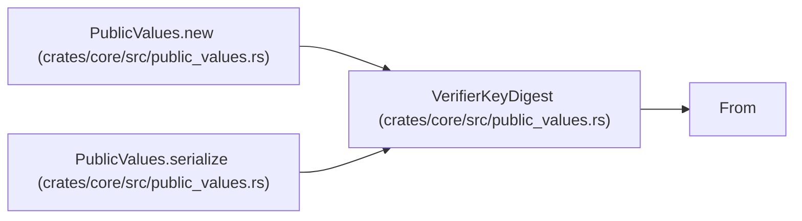

# VerifierKeyDigest

**Location:** `crates/core/src/public_values.rs:14`
**Kind:** Class
**Bases:** `From`
**Module:** [public_values](../modules/public_values.md)

## Description

Digest of a program verifier key.

## Attributes

*No annotated attributes found.*

## Methods

| Method | Signature | Decorators | Description |
|--------|-----------|------------|-------------|
| `from_raw` | `(raw: [u32 ; 8]) -> Self` | — | — |
| `as_raw` | `() -> &[u32 ; 8]` | — | — |
| `into_raw` | `() -> [u32 ; 8]` | — | — |
| `from_bytes` | `(bytes: [u8 ; 32]) -> Self` | — | — |
| `from` | `(value: [u32 ; 8]) -> Self` | — | — |

## Relationships

<!-- Auto-generated relationship summary. Do not edit by hand. -->

### Summary

| Module | Methods | Attributes |
|---|---:|---|
| [public_values](../modules/public_values.md) | 5 | — |

### Structure

| Kind | Entity | Module |
|---|---|---|
| Base | `From` | — |

### References

| Reference | Kind | Source | Call sites |
|---|---|---|---:|
| `PublicValues.new` | type_reference | [public_values](../modules/public_values.md) | — |
| `PublicValues.serialize` | type_reference | [public_values](../modules/public_values.md) | — |
