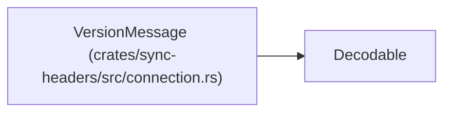

# VersionMessage

**Location:** `crates/sync-headers/src/connection.rs:88`
**Kind:** Class
**Bases:** `Decodable`
**Module:** [src_connection](../modules/src_connection.md)

**Decorators:** `@Debug`

## Description

Simplified version message structure.

## Attributes

| Name | Type | Default | Description |
|------|------|---------|-------------|
| `version` | `i32` | *required* | — |
| `services` | `u64` | *required* | — |
| `timestamp` | `i64` | *required* | — |
| `receiver_services` | `u64` | *required* | — |
| `sender_services` | `u64` | *required* | — |
| `nonce` | `u64` | *required* | — |
| `user_agent` | `String` | *required* | — |
| `starting_height` | `i32` | *required* | — |

## Methods

| Method | Signature | Decorators | Description |
|--------|-----------|------------|-------------|
| `consensus_decode` | `(d: &mut D) -> std::result::Result<Self, encode::Error >` | — | — |

## Relationships

<!-- Auto-generated relationship summary. Do not edit by hand. -->

### Summary

| Module | Methods | Attributes |
|---|---:|---|
| [src_connection](../modules/src_connection.md) | 1 | `nonce`, `receiver_services`, `sender_services`, `services`, `starting_height`, `timestamp`, `user_agent`, `version` |

### Structure

| Kind | Entity | Module |
|---|---|---|
| Base | `Decodable` | — |
