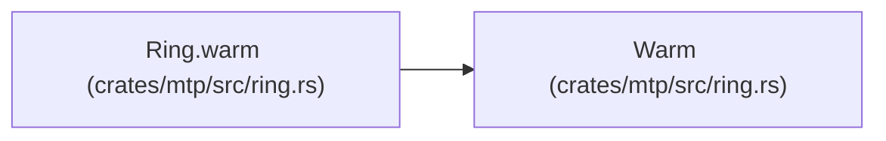

# Warm

**Location:** `crates/mtp/src/ring.rs:17`
**Kind:** Class
**Bases:** —
**Module:** [ring](../modules/ring.md)

**Decorators:** `@Debug`, `@Clone`, `@Copy`, `@Default`, `@PartialEq`, `@Eq`

## Description

Every slot in the ring holds a timestamp.

## Attributes

*No annotated attributes found.*

## Methods

*No public methods. Inherits from base classes.*

## Relationships

<!-- Auto-generated relationship summary. Do not edit by hand. -->

### Summary

| Module | Methods | Attributes |
|---|---:|---|
| [ring](../modules/ring.md) | 0 | — |

### References

| Reference | Kind | Source | Call sites |
|---|---|---|---:|
| `Ring.warm` | type_reference | [ring](../modules/ring.md) | — |
