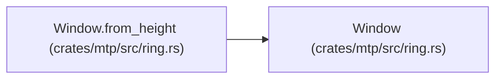

# Window

**Location:** `crates/mtp/src/ring.rs:11`
**Kind:** Type alias
**Bases:** —
**Module:** [ring](../modules/ring.md)

## Description

The consensus timestamp window.

## Attributes

*No annotated attributes found.*

## Methods

| Method | Signature | Decorators | Description |
|--------|-----------|------------|-------------|
| `from_height` | `(values: WindowValues, height: u32) -> Result<Self, InvalidParts >` | — | Rebuild a cold consensus window from persisted slots at `height`. |
| `from_height` | `(values: WindowValues, height: u32) -> Result<Self, InvalidParts >` | — | Rebuild a warm consensus window from persisted slots at `height`. |

## Relationships

<!-- Auto-generated relationship summary. Do not edit by hand. -->

### Summary

| Module | Methods | Attributes |
|---|---:|---|
| [ring](../modules/ring.md) | 2 | — |

### References

| Reference | Kind | Source | Call sites |
|---|---|---|---:|
| `Window.from_height` | type_reference | [ring](../modules/ring.md) | — |
