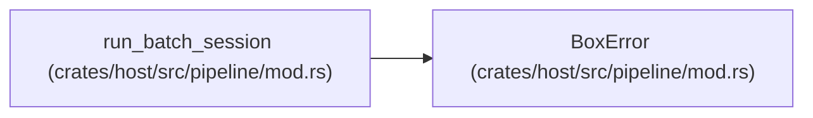

# BoxError

**Location:** `crates/host/src/pipeline/mod.rs:41`
**Kind:** Type alias
**Bases:** —
**Module:** [host_src_pipeline_mod](../modules/host_src_pipeline_mod.md)

## Description

_Auto-generated from `BoxError` in `crates/host/src/pipeline/mod.rs`._

## Attributes

*No annotated attributes found.*

## Methods

*No public methods. Inherits from base classes.*

## Relationships

<!-- Auto-generated relationship summary. Do not edit by hand. -->

### Summary

| Module | Methods | Attributes |
|---|---:|---|
| [host_src_pipeline_mod](../modules/host_src_pipeline_mod.md) | 0 | — |

### References

| Reference | Kind | Source | Call sites |
|---|---|---|---:|
| `run_batch_session` | type_reference | [host_src_pipeline_mod](../modules/host_src_pipeline_mod.md) | — |
