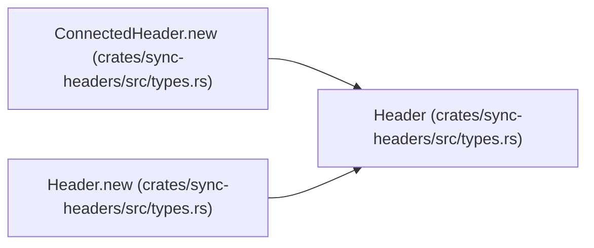

# Header

**Location:** `crates/sync-headers/src/types.rs:94`
**Kind:** Class
**Bases:** —
**Module:** [src_types](../modules/src_types.md)

**Decorators:** `@Debug`, `@Clone`

## Description

A raw block header received from the network.

## Attributes

| Name | Type | Default | Description |
|------|------|---------|-------------|
| `inner` | `CoreHeader` | *required* | — |

## Methods

| Method | Signature | Decorators | Description |
|--------|-----------|------------|-------------|
| `new` | `(inner: CoreHeader) -> Self` | — | — |
| `block_hash` | `() -> BlockHash` | — | — |
| `prev_blockhash` | `() -> BlockHash` | — | — |

## Relationships

<!-- Auto-generated relationship summary. Do not edit by hand. -->

### Summary

| Module | Methods | Attributes |
|---|---:|---|
| [src_types](../modules/src_types.md) | 3 | `inner` |

### References

| Reference | Kind | Source | Call sites |
|---|---|---|---:|
| `ConnectedHeader.new` | type_reference | [src_types](../modules/src_types.md) | — |
| `Header.new` | type_reference | [src_types](../modules/src_types.md) | — |
