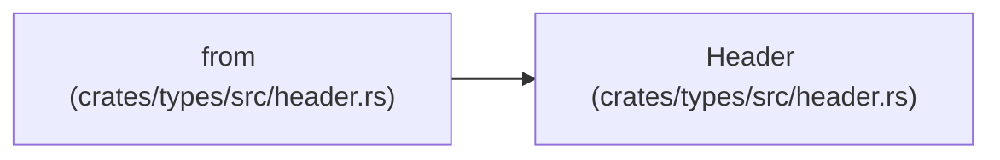

# Header

**Location:** `crates/types/src/header.rs:5`
**Kind:** Class
**Bases:** —
**Module:** [types_src_header](../modules/types_src_header.md)

## Description

A Bitcoin block header

## Attributes

| Name | Type | Default | Description |
|------|------|---------|-------------|
| `version` | `u32` | *required* | — |
| `prev_blockhash` | `BlockHash` | *required* | — |
| `merkle_root` | `[u8 ; 32]` | *required* | — |
| `timestamp` | `BlockTimestamp` | *required* | — |
| `compact_target` | `CompactTarget` | *required* | — |
| `nonce` | `u32` | *required* | — |

## Methods

| Method | Signature | Decorators | Description |
|--------|-----------|------------|-------------|
| `to_bytes_const` | `() -> [u8 ; Self::SIZE]` | — | Only for const evaluation. `zkpow-params` derives a network's genesis hash at compile |

## Relationships

<!-- Auto-generated relationship summary. Do not edit by hand. -->

### Summary

| Module | Methods | Attributes |
|---|---:|---|
| [types_src_header](../modules/types_src_header.md) | 1 | `compact_target`, `merkle_root`, `nonce`, `prev_blockhash`, `timestamp`, `version` |

### References

| Reference | Kind | Source | Call sites |
|---|---|---|---:|
| `from` | type_reference | [types_src_header](../modules/types_src_header.md) | — |
