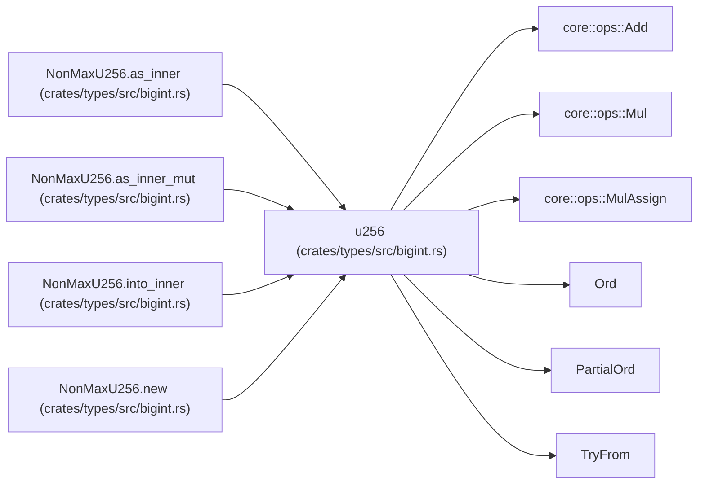

# u256

**Location:** `crates/types/src/bigint.rs:10`
**Kind:** Class
**Bases:** `core::ops::Add`, `core::ops::MulAssign`, `core::ops::Mul`, `PartialOrd`, `Ord`, `TryFrom`
**Module:** [src_bigint](../modules/src_bigint.md)

## Description

A 256-bit unsigned integer stored as four little-endian u64 limbs.

## Attributes

*No annotated attributes found.*

## Methods

| Method | Signature | Decorators | Description |
|--------|-----------|------------|-------------|
| `from_limbs` | `(limbs: [u64 ; 4]) -> Self` | — | Construct from little-endian limbs. |
| `as_limbs` | `() -> &[u64 ; 4]` | — | Borrow the little-endian limbs. |
| `as_limbs_mut` | `() -> &mut [u64 ; 4]` | — | Borrow the little-endian limbs mutably. |
| `into_limbs` | `() -> [u64 ; 4]` | — | Consume into little-endian limbs. |
| `from_le_bytes` | `(bytes: [u8 ; 32]) -> Self` | — | Construct from a 32-byte little-endian byte array. |
| `from_words` | `(words: &[u64 ; 8]) -> Self` | — | Construct from eight 32-bit big-endian SHA state words. |
| `to_le_bytes` | `() -> [u8 ; 32]` | — | Serialize to a 32-byte little-endian byte array. |
| `leading_zeros` | `() -> u32` | — | Return the number of leading zero bits in the 256-bit representation. |
| `bits` | `() -> u32` | — | Return the minimum number of bits required to represent this integer. |
| `add` | `(rhs: Self) -> Self::Output` | — | — |
| `mul_assign` | `(rhs: u32)` | — | — |
| `mul` | `(rhs: u32) -> Self::Output` | — | — |
| `partial_cmp` | `(other: &Self) -> Option<core::cmp::Ordering >` | — | — |
| `cmp` | `(other: &Self) -> core::cmp::Ordering` | — | — |
| `try_from` | `(value: &[u8]) -> Result<Self, Self::Error >` | — | — |

## Relationships

<!-- Auto-generated relationship summary. Do not edit by hand. -->

### Summary

| Module | Methods | Attributes |
|---|---:|---|
| [src_bigint](../modules/src_bigint.md) | 15 | — |

### Structure

| Kind | Entity | Module |
|---|---|---|
| Base | `core::ops::Add` | — |
| Base | `core::ops::Mul` | — |
| Base | `core::ops::MulAssign` | — |
| Base | `Ord` | — |
| Base | `PartialOrd` | — |
| Base | `TryFrom` | — |

### References

| Reference | Kind | Source | Call sites |
|---|---|---|---:|
| `NonMaxU256.as_inner` | type_reference | [src_bigint](../modules/src_bigint.md) | — |
| `NonMaxU256.as_inner_mut` | type_reference | [src_bigint](../modules/src_bigint.md) | — |
| `NonMaxU256.into_inner` | type_reference | [src_bigint](../modules/src_bigint.md) | — |
| `NonMaxU256.new` | type_reference | [src_bigint](../modules/src_bigint.md) | — |
