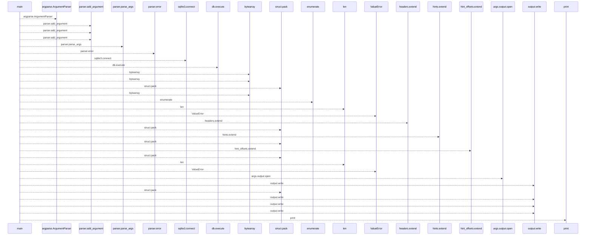
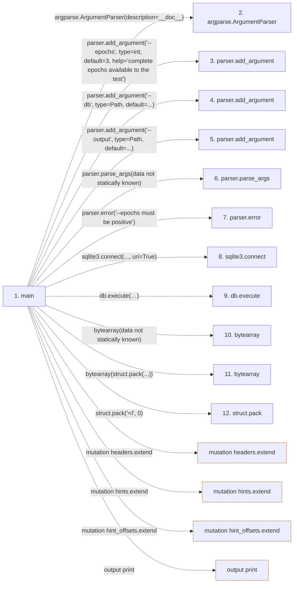

# generate-epoch-profile-fixture

**Entry point:** `main` (`process`)
**Source:** [generate-epoch-profile-fixture](../modules/generate-epoch-profile-fixture.md)
**Modules touched:** [generate-epoch-profile-fixture](../modules/generate-epoch-profile-fixture.md)

## Call sequence

<!-- Auto-generated from static call edges. Dashed arrows are external or unresolved calls. Reviewed runtime conditions and side effects belong in Behavior. -->

## Data flow

<!-- Auto-generated static analysis. Treat values and boundaries as best-effort hints, not runtime proof. -->

### Step data

| Step | Inputs | Reads | Writes | Returns |
|---|---|---|---|---|
| `main` | - | `Path`, `ROOT`, `Path`, `ROOT`, `EPOCH_LENGTH` | - | - |
| `argparse.ArgumentParser` | - | - | - | - |
| `parser.add_argument` | - | - | - | - |
| `parser.add_argument` | - | - | - | - |
| `parser.add_argument` | - | - | - | - |
| `parser.parse_args` | - | - | - | - |
| `parser.error` | - | - | - | - |
| `sqlite3.connect` | - | - | - | - |
| `db.execute` | - | - | - | - |
| `bytearray` | - | - | - | - |
| `bytearray` | - | - | - | - |
| `struct.pack` | - | - | - | - |

### Call data

| From | To | Line | Call |
|---|---|---:|---|
| main | argparse.ArgumentParser | 14 | `argparse.ArgumentParser(description=__doc__)` |
| main | parser.add_argument | 15 | `parser.add_argument('--epochs', type=int, default=3, help='complete epochs available to the test')` |
| main | parser.add_argument | 16 | `parser.add_argument('--db', type=Path, default=...)` |
| main | parser.add_argument | 17 | `parser.add_argument('--output', type=Path, default=...)` |
| main | parser.parse_args | 18 | `parser.parse_args(data not statically known)` |
| main | parser.error | 20 | `parser.error('--epochs must be positive')` |
| main | sqlite3.connect | 23 | `sqlite3.connect(..., uri=True)` |
| main | db.execute | 24 | `db.execute('SELECT height, version, merkle_root, timestamp, nonce, median_time_past, ordered_timestamp_run FROM headers WHERE height BETWEEN 1 AND ? ORDER BY height', (...))` |
| main | bytearray | 28 | `bytearray(data not statically known)` |
| main | bytearray | 29 | `bytearray(struct.pack(...))` |
| main | struct.pack | 29 | `struct.pack('<I', 0)` |

### Boundary effects

| Kind | Target | Step | Line |
|---|---|---|---:|
| mutation | `headers.extend` | `main` | 36 |
| mutation | `hints.extend` | `main` | 38 |
| mutation | `hint_offsets.extend` | `main` | 39 |
| output | `print` | `main` | 49 |

### Static analysis gaps

| Kind | Step | Target | Line |
|---|---|---|---:|
| external_call | `main` | `argparse.ArgumentParser` | 14 |
| unresolved_call | `main` | `parser.add_argument` | 15 |
| unresolved_call | `main` | `parser.add_argument` | 16 |
| unresolved_call | `main` | `parser.add_argument` | 17 |
| unresolved_call | `main` | `parser.parse_args` | 18 |
| unresolved_call | `main` | `parser.error` | 20 |
| external_call | `main` | `sqlite3.connect` | 23 |
| unresolved_call | `main` | `db.execute` | 24 |
| external_call | `main` | `bytearray` | 28 |
| external_call | `main` | `bytearray` | 29 |
| external_call | `main` | `struct.pack` | 29 |
| step_limit | `main` | `first 12 steps` | 0 |

## Behavior

Exports mainnet headers 1 through `epochs * 2016 + 1` (default 3 epochs) from a read-only `headers.db` into `fixtures/epoch_profile_headers.bin`. That file is the input of the opt-in zkVM epoch profile tests in `crates/core/src/tests/state/profile.rs`.

The file is little-endian: a `u32` header count; each header's `version`, `merkle_root`, `timestamp`, and `nonce` (the [`HeaderInput`](../entities/HeaderInput.md) fields, since the guest derives `prev_blockhash` and the target); a `u32` hint-offset table with one entry before the first header and one after each; then the median-time-past hints. A header gets a hint from height 11 on, and only when the previous row's `ordered_timestamp_run` is below 10. This is the rule in `zkpow_mtp::requires_median_hint`.

A gap in heights, a `merkle_root` that is not 32 bytes, or too few rows raises `ValueError` before the output file is opened. `--epochs` below 1 is a usage error.
