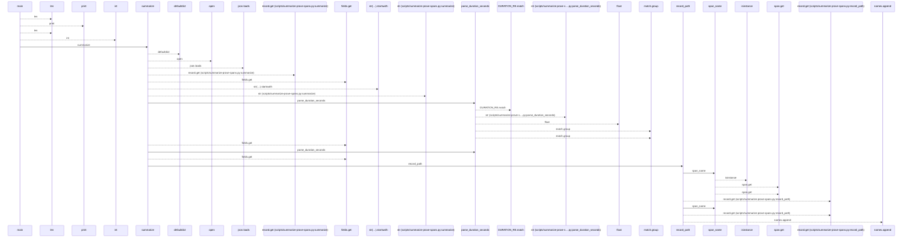
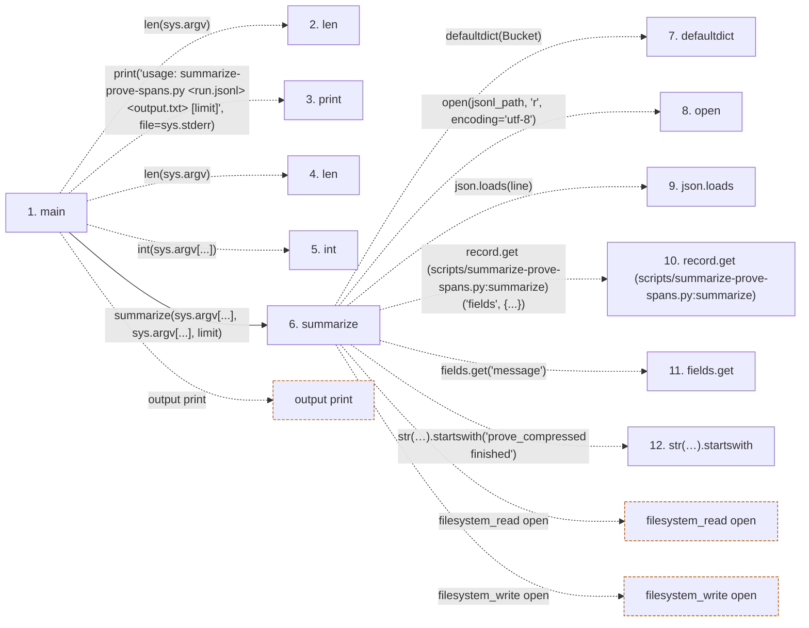

# summarize-prove-spans

**Entry point:** `main` (`process`)
**Source:** [summarize-prove-spans](../modules/summarize-prove-spans.md)
**Modules touched:** [summarize-prove-spans](../modules/summarize-prove-spans.md)

## Call sequence

<!-- Auto-generated from static call edges. Dashed arrows are external or unresolved calls. Reviewed runtime conditions and side effects belong in Behavior. -->

> Call sequence diagram shows 30 of 51 interactions; 21 omitted to keep the visualization within the 30-interaction and generated-diagram limits.

## Data flow

<!-- Auto-generated static analysis. Treat values and boundaries as best-effort hints, not runtime proof. -->

### Step data

| Step | Inputs | Reads | Writes | Returns |
|---|---|---|---|---|
| `main` | - | `sys`, `sys`, `sys`, `sys` | - | `2`, `0` |
| `len` | - | - | - | - |
| `print` | - | - | - | - |
| `len` | - | - | - | - |
| `int` | - | - | - | - |
| `summarize` | `jsonl_path`, `output_path`, `limit` | `Bucket`, `json` | `bucket.busy`, `bucket.idle`, `bucket.count` | `none`, `none` |
| `defaultdict` | - | - | - | - |
| `open` | - | - | - | - |
| `json.loads` | - | - | - | - |
| `record.get (scripts/summarize-prove-spans.py:summarize)` | - | - | - | - |
| `fields.get` | - | - | - | - |
| `str(…).startswith` | - | - | - | - |

### Call data

| From | To | Line | Call |
|---|---|---:|---|
| main | len | 144 | `len(sys.argv)` |
| main | print | 145 | `print('usage: summarize-prove-spans.py <run.jsonl> <output.txt> [limit]', file=sys.stderr)` |
| main | len | 150 | `len(sys.argv)` |
| main | int | 150 | `int(sys.argv[...])` |
| main | summarize | 151 | `summarize(sys.argv[...], sys.argv[...], limit)` |
| summarize | defaultdict | 66 | `defaultdict(Bucket)` |
| summarize | open | 71 | `open(jsonl_path, 'r', encoding='utf-8')` |
| summarize | json.loads | 74 | `json.loads(line)` |
| summarize | record.get (scripts/summarize-prove-spans.py:summarize) | 78 | `record.get('fields', {...})` |
| summarize | fields.get | 79 | `fields.get('message')` |
| summarize | str(…).startswith | 84 | `str(message).startswith('prove_compressed finished')` |

### Boundary effects

| Kind | Target | Step | Line |
|---|---|---|---:|
| output | `print` | `main` | 145 |
| filesystem_read | `open` | `summarize` | 71 |
| filesystem_write | `open` | `summarize` | 108 |

### Static analysis gaps

| Kind | Step | Target | Line |
|---|---|---|---:|
| external_call | `summarize` | `defaultdict` | 66 |
| external_call | `summarize` | `json.loads` | 74 |
| unresolved_call | `summarize` | `record.get` | 78 |
| unresolved_call | `summarize` | `fields.get` | 79 |
| unresolved_call | `summarize` | `str(message).startswith` | 84 |
| step_limit | `main` | `first 12 steps` | 0 |

## Behavior

Reads a `tracing` JSON log (the `logs/run.jsonl` written during `scripts/profile-sp1.sh`) and writes a text table of where SP1's `prove_compressed` spent wall-clock time. Only `close` events between the `prove_compressed started` and `prove_compressed finished` messages count. Each event's `time.busy` and `time.idle` (in ns, µs/us, ms, or s) are summed into a bucket keyed by span path. The path drops `runtime.spawn` and a leading `prove_compressed_detail`, and labels `prove` spans with their `mode`. Rows sort by busy time, then idle time, and the top `limit` (default 40) are written.

Spans nest and can overlap, so the totals rank spans; they do not add up to the proof's wall time. With no start marker, or no close events because the run lacked `PROVE_COMPRESSED_SPANS=1`, the output says so instead of printing a table. A log that ends before the finish marker gets a warning line. A wrong argument count prints usage and exits 2. Lines that are not JSON are skipped.
