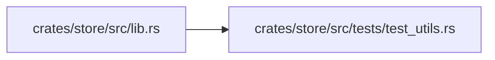

# lib Module

**Path:** `crates/store/src/lib.rs`

## Description

Crate root of `zkpow-store`. Re-exports [db](src_db.md) and resolves the database path: `ZKPOW_DB_PATH` if set, else `headers.db` at the workspace root. Test fixtures are public under `cfg(test)` or the `test-utils` feature.

## Imports

| Source | Symbols |
|--------|---------|
| `db::Error` | `Error` |
| `db::HeaderBatchWitness` | `HeaderBatchWitness` |
| `db::HeaderRecord` | `HeaderRecord` |
| `db::HeaderStore` | `HeaderStore` |
| `db::Result` | `Result` |
| `db::ResultOpt` | `ResultOpt` |
| `db::RunRecord` | `RunRecord` |
| `db::SQLITE_MEMORY_DATABASE` | `SQLITE_MEMORY_DATABASE` |
| `db::genesis_state_from_record` | `genesis_state_from_record` |
| `std::path::PathBuf` | `PathBuf` |
| `tests::test_utils` | `test_utils` |

## Local dependency map

<!-- Auto-generated local dependency summary. Do not edit by hand. -->

### Internal neighbors

| Direction | Module |
|---|---|
| Outbound | [test_utils](../modules/test_utils.md) |

### External packages

| Language | Used packages | Undeclared packages |
|---|---:|---:|
| rust | 1 | 1 |

## Functions

| Function | Signature | Decorators | Description |
|----------|-----------|------------|-------------|
| `db_path` | `() -> PathBuf` | — | Resolve the SQLite header database path: `ZKPOW_DB_PATH` if set, otherwise |
