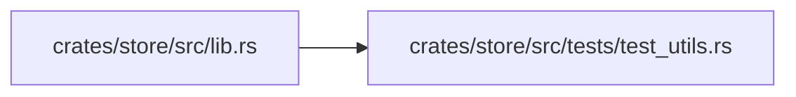

# test_utils Module

**Path:** `crates/store/src/tests/test_utils.rs`

## Description

_Auto-generated from `crates/store/src/tests/test_utils.rs`._

## Imports

| Source | Symbols |
|--------|---------|
| `crate::HeaderStore` | `HeaderStore` |
| `crate::db::SQLITE_MEMORY_DATABASE` | `SQLITE_MEMORY_DATABASE` |

## Local dependency map

<!-- Auto-generated local dependency summary. Do not edit by hand. -->

### Internal neighbors

| Direction | Module |
|---|---|
| Inbound | [store_src_lib](../modules/store_src_lib.md) |

## Functions

| Function | Signature | Decorators | Description |
|----------|-----------|------------|-------------|
| `in_memory_store` | `() -> HeaderStore` | — | — |
| `create_test_fixture_store` | `() -> HeaderStore` | — | — |
