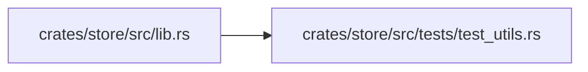

# test_utils Module

**Path:** `crates/store/src/tests/test_utils.rs`

## Description

_Auto-generated from `crates/store/src/tests/test_utils.rs`._

## Imports

| Source | Symbols |
|--------|---------|
| `crate::HeaderStore` | `HeaderStore` |
| `crate::db::SQLITE_MEMORY_DATABASE` | `SQLITE_MEMORY_DATABASE` |
| `std::fs` | `fs` |
| `std::path::Path` | `Path` |
| `std::path::PathBuf` | `PathBuf` |
| `std::time::SystemTime` | `SystemTime` |
| `std::time::UNIX_EPOCH` | `UNIX_EPOCH` |
| `sync_headers::ConnectedHeader` | `ConnectedHeader` |
| `sync_headers::Header` | `Header` |
| `zkpow_core::BlockHash` | `BlockHash` |
| `zkpow_core::BlockTimestamp` | `BlockTimestamp` |
| `zkpow_core::ChainWork` | `ChainWork` |
| `zkpow_core::block_work_from_target` | `block_work_from_target` |
| `zkpow_core::target_from_bits` | `target_from_bits` |
| `zkpow_params::Consensus` | `Consensus` |
| `zkpow_params::Mainnet` | `Mainnet` |

## Local dependency map

<!-- Auto-generated local dependency summary. Do not edit by hand. -->

### Internal neighbors

| Direction | Module |
|---|---|
| Inbound | [store_src_lib](../modules/store_src_lib.md) |

### External packages

| Language | Used packages | Undeclared packages |
|---|---:|---:|
| rust | 3 | 1 |

## Functions

| Function | Signature | Decorators | Description |
|----------|-----------|------------|-------------|
| `temp_db_path` | `(test_name: &str) -> PathBuf` | — | — |
| `remove_db_files` | `(path: &Path)` | — | — |
| `seeded_store_at` | `(path: &Path, count: u32) -> (HeaderStore, BlockHash)` | — | A genesis-seeded store with `count` more headers appended at `path`. |
| `seeded_store` | `(test_name: &str) -> (HeaderStore, PathBuf, BlockHash)` | — | A genesis-seeded store with 20 more headers appended in a temporary database file. |
| `create_real_seeded_store` | `(path: &Path, max_height: u32) -> HeaderStore` | — | Creates an isolated store at `path` populated with real mined headers up to `max_height` |
| `create_test_fixture_store` | `() -> HeaderStore` | — | Creates an in-memory HeaderStore populated with standard test fixture headers: |
