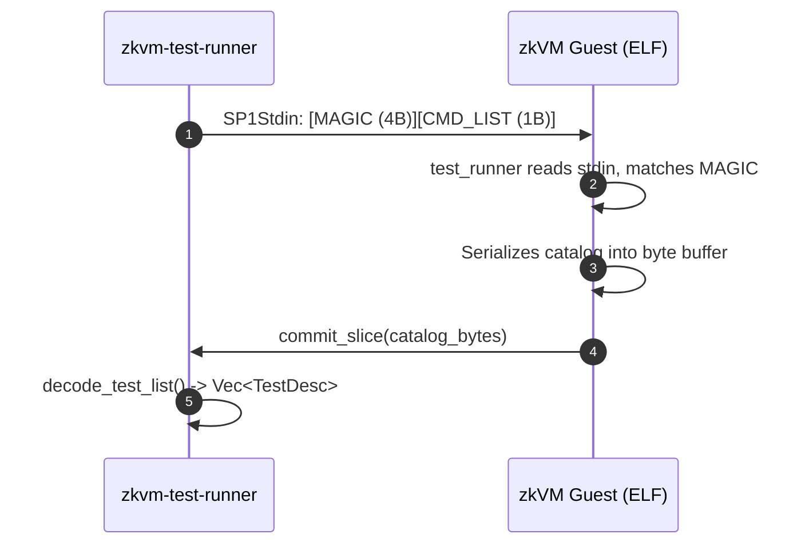
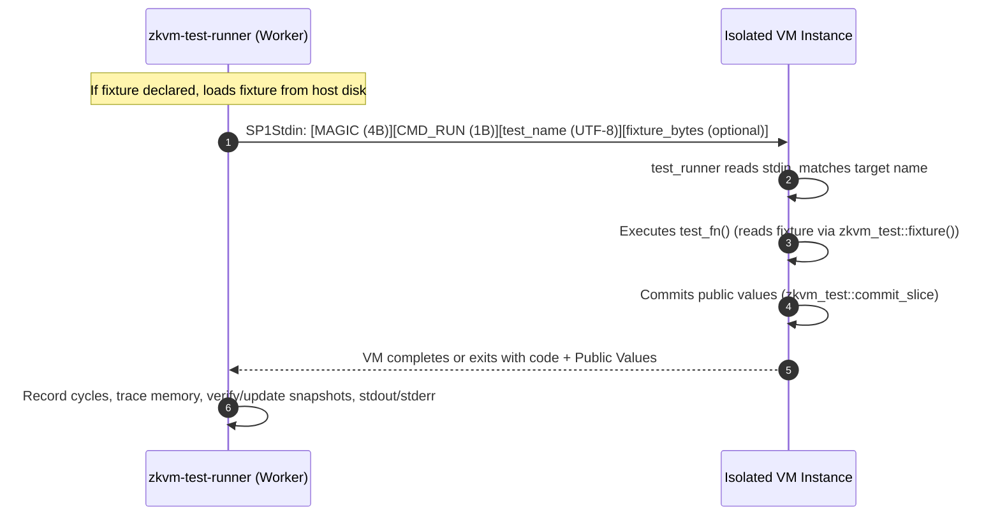

# zkvm-test: Architecture & Technical Specification

`zkvm-test` is a Nextest-grade, cycle-aware, multi-backend testing framework and CLI runner for zero-knowledge virtual machines (SP1 and RISC Zero).

It brings the ergonomics, speed, and safety of modern Rust test runners (`cargo test` and `cargo nextest`) into zkVM guest environments—providing **per-test isolation**, **concurrency**, **guest output capture**, **sub-routine cycle profiling**, **deterministic memory metrics**, and **CI performance regression gates**.

---

## 1. Problem Statement

Testing zkVM guest code has traditionally been difficult and painful:

1. **Catastrophic Failure Cascades**: In standard zkVM harnesses, a `panic!` in a guest test triggers an emulator abort or unhandled trap that immediately terminates the entire VM process. One failing test halts the entire test suite.
2. **Zero Concurrency**: Standard test runners execute sequentially in a single thread, causing test suites with dozens of crypto and state transitions to take minutes instead of seconds.
3. **No Per-Test Filtering**: Developers cannot easily filter tests by substring, exact name, or run ignored tests (`cargo test <filter>` / `--exact` / `--ignored`).
4. **Missing Test Semantics**: Attributes like `#[should_panic]`, expected exit codes, and cycle budgets are unsupported or require custom boilerplate per test.
5. **No Output Capture**: Guest `stdout` / `stderr` (`println!`, `eprintln!`, panic backtraces) either gets silently dropped or dumps unconditionally into the terminal during multithreaded runs, interleaving text into an unreadable mess.
6. **Blindness to Compute & Memory Cost**: Traditional runners report only wall-clock time. In zkVM development, wall-clock time is noisy and irrelevant; what matters is **instruction cycles**, **hierarchical sub-routine breakdown**, and **proving execution trace size**.
7. **No Regression Gating**: Subtle algorithmic regressions that double cycle counts easily slip into production without an automated cycle budget or baseline comparison mechanism in CI.

---

## 2. Architecture Overview

`zkvm-test` is organized into three decoupled crates:

```text
+-------------------------------------------------------------------------+
|                               HOST OS                                   |
|                                                                         |
|  cargo zkvm-test [CARGO_OPTS] [--] [RUNNER_OPTS] [FILTERS]               |
|         │                                                               |
|         ▼                                                               |
|  ┌───────────────────────────────────────────────────────────────────┐  |
|  │ cargo-zkvm-test (crates/zkvm-test-runner/src/cargo_plugin.rs)     │  |
|  │  - Invokes: cargo test --no-run --target riscv64im-... --json     │  |
|  │  - Discovers compiler artifacts (.elf binaries)                   │  |
|  │  - Dispatches execution to zkvm_test_runner::runner::run          │  |
|  └─────────────────────────────────┬─────────────────────────────────┘  |
|                                    │                                    |
|                                    ▼                                    |
|  ┌───────────────────────────────────────────────────────────────────┐  |
|  │ zkvm-test-runner (crates/zkvm-test-runner/src/runner.rs)          │  |
|  │  - AnyProver Engine: MockProver | CpuProver | CudaProver          │  |
|  │  - Phase 1: Query catalog via IPC protocol (MAGIC + CMD_LIST)     │  |
|  │  - Tokio Concurrency Pool (Semaphore, std::thread::parallelism)   │  |
|  │  - Phase 2: Parallel isolated VM spawns (MAGIC + CMD_RUN + name)  │  |
|  │  - Output Streams: tokio::sync::watch::channel (stdout / stderr)  │  |
|  │  - Cycle Tracking, Trace Memory, Baseline Diff & Regression Gate  │  |
|  └─────────────────────────────────┬─────────────────────────────────┘  |
+------------------------------------┼------------------------------------+
                                     │ SP1Stdin / SP1PublicValues
                                     ▼
+-------------------------------------------------------------------------+
|                       zkVM GUEST ENVIRONMENT                            |
|                     (riscv64im-succinct-zkvm-elf)                       |
|                                                                         |
|  ┌───────────────────────────────────────────────────────────────────┐  |
|  │ zkvm-test (crates/zkvm-test/src/lib.rs)                           │  |
|  │  - #![no_std] runtime harness                                     │  |
|  │  - test_runner(&[&TestCase]) registered via #![test_runner]       │  |
|  │  - Responds to CMD_LIST with serialized test catalog              │  |
|  │  - Routes CMD_RUN directly to target test function                │  |
|  └─────────────────────────────────▲─────────────────────────────────┘  |
|                                    │                                    |
|  ┌─────────────────────────────────┴─────────────────────────────────┐  |
|  │ zkvm-test-macros (crates/zkvm-test-macros/src/lib.rs)             │  |
|  │  - #[zkvm_test] and #[test] proc macros                          │  |
|  │  - Dual compilation:                                              |  |
|  │    • target_os = "zkvm": #[test_case] static TestCase registration│  |
|  │    • host: standard #[::core::prelude::v1::test]                  │  |
|  └───────────────────────────────────────────────────────────────────┘  |
+-------------------------------------------------------------------------+
```

---

## 3. Orchestration & Build Pipeline

### Cargo Plugin vs. Target Runner

`zkvm-test` operates through two complementary modalities:

1. **`cargo zkvm-test` (Recommended CLI Plugin)**:
   A turnkey wrapper that:
   - Dynamically selects the appropriate compiler toolchain (e.g. `+succinct` for `riscv64im-succinct-zkvm-elf`, `+risc0` for `riscv32im-risc0-zkvm-elf`).
   - Executes `cargo test --no-run --message-format=json` with all forwarded cargo flags (`-p`, `--lib`, `--test`, `--release`, etc.).
   - Streams JSON compiler artifacts and extracts executable ELFs.
   - Executes each compiled ELF through `zkvm-test-runner` with full terminal formatting and status codes.

2. **`zkvm-test-runner` (Target Runner)**:
   Can be registered in `.cargo/config.toml` as a direct target runner:

   ```toml
   [target.riscv64im-succinct-zkvm-elf]
   runner = "zkvm-test-runner"
   ```

   When configured this way, executing `cargo test --target riscv64im-succinct-zkvm-elf` automatically launches `zkvm-test-runner <elf-path>`.

### Toolchain & Target Auto-Detection

The runner dynamically inspects the target triple to assign default toolchains without requiring manual environment variables:

```rust
pub const TARGET_VENDOR_SUCCINCT: &str = "succinct";
pub const TARGET_VENDOR_RISC0: &str = "risc0";

pub fn default_toolchain_for_target(target: &str) -> Option<&'static str> {
    if target.contains(TARGET_VENDOR_SUCCINCT) {
        Some("+succinct")
    } else if target.contains(TARGET_VENDOR_RISC0) {
        Some("+risc0")
    } else {
        None
    }
}
```

### Intelligent Workspace & Package Discovery

In multi-crate workspaces, running `cargo test --target <zkvm-target>` across the entire workspace causes compiler errors because host-only crates (CLI tools, database drivers, async runtimes like `tokio` or `mio`) cannot compile for bare-metal zkVM targets.

When invoked without explicit `-p` or `--package` flags, `cargo-zkvm-test` queries `cargo metadata` and determines target packages using a layered discovery algorithm:

1. **Subdirectory Context**: If executed from inside a specific member crate's directory (e.g. `crates/sha256/`), it automatically defaults to testing only that crate (`-p zkpow-sha256`).
2. **Workspace Configuration (`Cargo.toml`)**:
   Explicit inclusion or exclusion at the root workspace level:
   ```toml
   [workspace.metadata.zkvm-test]
   # Explicit list of default test packages:
   packages = ["zkpow-core", "zkpow-sha256"]
   # Or packages to exclude:
   exclude = ["zkpow-cli", "zkpow-host", "zkvm-test-runner"]
   ```
3. **Package-Level Opt-In / Opt-Out (`Cargo.toml`)**:
   Individual member crates can declare themselves enabled or disabled:
   ```toml
   [package.metadata.zkvm-test]
   enable = false # Exclude this crate from workspace test runs
   ```
4. **Zero-Config Auto-Detection**:
   If no metadata is provided, `cargo-zkvm-test` scans workspace members:
   - Skips framework runner crates (`zkvm-test`, `zkvm-test-macros`, `zkvm-test-runner`).
   - Checks dependencies: any crate depending on `zkvm-test` (in regular or dev dependencies) is automatically selected.
   - Honors CLI `--exclude <package>` arguments.
   - Automatically injects `-p <pkg1> -p <pkg2> ...` into `cargo test --no-run`, ensuring only valid zkVM crates compile.

---

## 4. The Two-Phase Binary IPC Protocol (`ZKVT`)

To support test listing, filtering, and single-test execution without recompiling the ELF for every test, `zkvm-test` employs a lightweight binary protocol over standard zkVM input/output (`SP1Stdin` and `commit_slice`).

### Protocol Constants & Header

```rust
pub const MAGIC: &[u8; 4] = b"ZKVT";
pub const CMD_LIST: u8 = 0;
pub const CMD_RUN: u8 = 1;

pub const FLAG_IGNORE: u8             = 1 << 0; // 0x01
pub const FLAG_SHOULD_PANIC: u8       = 1 << 1; // 0x02
pub const FLAG_EXPECTED_EXIT_CODE: u8 = 1 << 2; // 0x04
pub const FLAG_MAX_CYCLES: u8         = 1 << 3; // 0x08
pub const FLAG_FIXTURE: u8            = 1 << 4; // 0x10
pub const FLAG_SNAPSHOT: u8           = 1 << 5; // 0x20
```

### Phase 1: Test Discovery (`CMD_LIST`)

Before running any test, the runner needs to know what tests exist, their names, and their attributes.



#### Catalog Binary Layout

The public values committed by the guest in Phase 1 follow this exact binary layout:

| Field | Type | Description |
|---|---|---|
| `count` | `u32` (LE) | Number of registered tests |
| **For each test:** | | |
| `flags` | `u8` | Bitmask of flags (`FLAG_IGNORE`, `FLAG_SHOULD_PANIC`, `FLAG_FIXTURE`, `FLAG_SNAPSHOT`, etc.) |
| `expected_exit_code` | `u32` (LE) | *(Optional)* Present only if `flags & FLAG_EXPECTED_EXIT_CODE != 0` |
| `max_cycles` | `u64` (LE) | *(Optional)* Present only if `flags & FLAG_MAX_CYCLES != 0` |
| `fixture_len` | `u32` (LE) | *(Optional)* Length of fixture path string, present only if `flags & FLAG_FIXTURE != 0` |
| `fixture_path` | `[u8; fixture_len]` | *(Optional)* UTF-8 fixture path string |
| `snapshot_len` | `u32` (LE) | *(Optional)* Length of snapshot path string, present only if `flags & FLAG_SNAPSHOT != 0` |
| `snapshot_path` | `[u8; snapshot_len]` | *(Optional)* UTF-8 snapshot path string |
| `name_len` | `u32` (LE) | Length of the test name string in bytes |
| `name_bytes` | `[u8; name_len]` | UTF-8 encoded full path test name |

### Phase 2: Isolated Execution (`CMD_RUN`)

Once the host runner has filtered the tests (matching CLI filters, `--exact`, `--ignored`, etc.), it schedules parallel executions. For each test:



If the guest panics or calls `exit(code)`, the VM process halts, but **only that single test instance terminates**. The host worker intercepts the exit code, correlates it against `expected_exit_code` or `should_panic`, and marks the test passed or failed. If a snapshot path was declared, the runner compares committed public values against the golden snapshot or updates it when `--accept-snapshots` is passed.

### Tier 1 Fallback (Legacy Libtest Compatibility)

If an ELF was compiled without `zkvm-test` (a standard libtest runner binary), the input will not contain `b"ZKVT"`. The guest harness automatically falls back to sequential execution of all non-ignored tests, and the runner reports the global result.

---

## 5. Guest Registry & Macro System

### Macro Expansion Architecture

The `#[zkvm_test]` attribute macro (and its alias `#[test]` via `use zkvm_test::test;`) performs dual compilation depending on the target architecture:

```rust
#[zkvm_test(max_cycles = 1_000_000, should_panic)]
fn test_critical_logic() { ... }
```

#### 1. Host Target (`not(target_os = "zkvm")`)

Emits standard Rust `#[test]` attributes, preserving standard `cargo test` compatibility:

```rust
#[::core::prelude::v1::test]
#[should_panic]
fn test_critical_logic() { ... }
```

#### 2. zkVM Target (`target_os = "zkvm"`)

Hooks into Rust's `#![custom_test_frameworks]` and emits a static `TestCase` struct:

```rust
fn test_critical_logic() { ... }

#[test_case]
static __ZKVM_TEST_CASE_test_critical_logic: ::zkvm_test::TestCase = ::zkvm_test::TestCase {
    name: concat!(module_path!(), "::", "test_critical_logic"),
    test_fn: test_critical_logic,
    ignore: false,
    should_panic: true,
    expected_exit_code: ::core::option::Option::None,
    max_cycles: ::core::option::Option::Some(1000000u64),
};
```

Because `TestCase` uses `&'static str` and function pointers, the entire test catalog is constructed statically in ROM without any heap allocations (`no_std` friendly).

---

## 6. Execution Pipeline, Concurrency & Stream Capture

### Concurrency Model

Tests are scheduled across a Tokio async runtime bounded by a `tokio::sync::Semaphore`. Concurrency defaults to `std::thread::available_parallelism()` (or `--test-threads <N>`):

```rust
let semaphore = Arc::new(tokio::sync::Semaphore::new(args.test_threads));
for test in tests_to_run {
    let permit = semaphore.acquire().await.unwrap();
    tokio::spawn(async move {
        // Run isolated VM instance
    });
}
```

### Guest Output Interception

Guest programs emit logs and panics via RISC-V `sys_write` (file descriptor `1` for stdout, `2` for stderr). The runner connects dedicated `tokio::sync::watch::channel` streams to each VM execution:

```rust
let (stdout_tx, stdout_rx) = tokio::sync::watch::channel(String::new());
let (stderr_tx, stderr_rx) = tokio::sync::watch::channel(String::new());

let res = prover.execute_test(Elf::from(elf_bytes), stdin, stdout_tx, stderr_tx).await;
```

- **Default Mode (Captured)**: Output is buffered in memory. If a test passes, output is suppressed to keep test logs readable.
- **Failure Diagnostic Mode**: If a test fails, its captured stdout and stderr are woven directly into the failure diagnostic block.
- **`--nocapture` Mode**: Sets concurrency to `1` (to prevent line interleaving) and immediately flushes stdout and stderr to the console.

---

## 7. Metrics, Profiling & Regression Gating

### Cycles vs. Wall-Clock Time

Wall-clock execution time varies widely based on CPU load, thermal throttling, and background tasks. `zkvm-test` treats **instruction cycles** (`report.total_instruction_count()`) as the primary unit of compute cost:

- 100% deterministic across machines and CI runners.
- Directly proportional to prover cost.

### Deterministic Trace Memory Attribution

Traditional host OS RSS (`getrusage`) is process-global. In concurrent multithreaded test runners, host RSS deltas between tests fluctuate wildly and can even be negative due to memory allocator page caching.

`zkvm-test` solves memory attribution by extracting the zkVM's **exact execution trace record size**:

```rust
let record_bytes = report.total_record_size();
```

- Completely deterministic per test.
- Reflects the exact memory footprint required by the zkVM STARK prover.
- Peak host RSS is simultaneously tracked at the suite level via `memuse::rss_kb()`.

### Hierarchical Sub-Routine Cycle Breakdown (`--profile`)

When tests utilize `sp1_cycle::run_track("label", || ...)` inside guest code, SP1's cycle tracker records sub-routine costs. Passing `--profile` (or `--subcycles`) renders an ASCII tree breakdown:

```text
test zkpow_sha256::tests::subroutine_cycle_profiling_demonstration ... ok (460,283 cycles, trace: 129.96 MB)
    ├── outer_pipeline: 386,802 cycles (84.0%) [1 call]
    ├── second_hash_pass: 186,267 cycles (40.5%) [1 call]
    └── first_hash_pass: 186,264 cycles (40.5%) [1 call]
```

### Granular Instruction & Syscall Breakdown (`--instructions`, `--opcodes`)

When `--instructions` or `--profile` is passed, the runner queries the SP1 opcode execution counts (`report.opcode_counts`) and syscall counts (`report.syscall_counts`), categorizing all 53 RISC-V opcodes:

- **ALU**: 18 standard arithmetic/bitwise opcodes (`ADD`, `SUB`, `XOR`, `AND`, etc. and immediate forms).
- **Memory**: 11 load/store instructions (`LW`, `SW`, `LD`, `SD`, byte/halfword variants).
- **Control**: 8 branching/jump instructions (`BEQ`, `BNE`, `JAL`, `JALR`, etc.).
- **Math**: 13 multiplication/division/remainder instructions (`MUL`, `DIV`, `REM`, 32-bit `*W`).
- **System**: 3 trap/fence opcodes (`ECALL`, `EBREAK`, `FENCE`).
- **Syscalls**: Top precompiles surfaced from `report.syscall_counts` (e.g. `SHA_COMPRESS`, `SHA_EXTEND`, `KECCAK_PERMUTE`).

```text
    ├── Instructions:
    │   ├── Memory:       48,154 (54.2%)
    │   ├── ALU:          24,082 (27.1%)
    │   ├── Control:      16,499 (18.6%)
    │   ├── Math:            125 (0.1%)
    │   └── System:            6 (0.0%)
    └── Syscalls:
        ├── SHA_EXTEND: 150 calls
        └── SHA_COMPRESS: 150 calls
```

### Baseline Comparison & CI Regression Gating

Metrics can be snapshotted to disk and verified in CI:

1. **Saving a Baseline**:
   `cargo zkvm-test --save-baseline main`
   Serializes all test metrics to `.zkvm-test-metrics/main.json`.
2. **Comparing Against a Baseline**:
   `cargo zkvm-test --compare-baseline main`
   Renders a formatted variance table:

   ```text
   Baseline comparison against 'main':
   Test Name                                                          Baseline        Current         Change
   ----------------------------------------------------------------------------------------------------------
   zkpow_core::tests::process_blocks_pipeline                       18,420,102     18,510,004          +0.5%
   zkpow_sha256::tests::public_values_optimized_hash                   268,979        268,979           0.0%
   ----------------------------------------------------------------------------------------------------------
   ```

3. **Automated CI Regression Gate**:
   `cargo zkvm-test --compare-baseline main --fail-on-regression 5%`
   If any test's cycle count increases by more than the specified percentage, the runner flags `[REGRESSION]` and exits with non-zero exit code `1`.

---

## 8. Multi-Backend Prover Support & Proof Mode Control

### Prover Backends

The runner abstracts prover execution behind `AnyProver`:

| Prover Backend | Flag | Description | Typical Use Case |
|---|---|---|---|
| **Mock** | `--prover mock` (Default) | Emulates instruction execution without generating STARK proofs. | Fast local unit testing, cycle tracking, and CI checks. |
| **CPU** | `--prover cpu` | Executes full local CPU STARK proving. | Local end-to-end proof verification. |
| **CUDA** | `--prover cuda` | Leverages local NVIDIA GPU acceleration. | High-performance full proving and hardware stress tests. |

Can also be set globally via environment variable `ZKVM_PROVER=cpu`.

### Proof Mode Control (`--mode` / `--proof-mode`)

By default (`--mode none`), tests simulate VM execution to maximize development velocity. When testing cryptographic proving pipelines, `zkvm-test` supports:

- **`none`**: Simulation only (zero proving overhead).
- **`core`**: SP1 Core STARK proof generation and cryptographic verification.
- **`compressed`**: Two-layer recursive STARK compression proof.
- **`plonk`**: PLONK SNARK generation (EVM verifier compatible).
- **`groth16`**: Constant-size Groth16 SNARK generation (minimal on-chain gas).

#### Architecture & Optimization
1. **Single Proving Key (`pk`) Setup Per ELF**:
   Generating proving keys via `prover.setup_pk(elf)` is compute-intensive (~0.5s). The runner executes PK setup **once per ELF** upfront and wraps the result in an `Arc<SP1ProvingKey>` shared across all worker threads.
2. **Execute-First Soundness**:
   The runner always executes tests through `prover.execute_test()` first. If assertions or panics fail, failure output is surfaced immediately without wasting minutes generating STARK proofs for broken code.
3. **Cryptographic Verification**:
   When `--mode <mode>` is specified, the runner generates the proof via `prover.prove_test()` and verifies it against the verifying key (`vk`) with `prover.verify(&proof, &vk)`. Successful verification and proof generation duration are displayed in the test summary.

---

## 9. Roadmap & Future Improvements

### Improvements Round 1 (Completed)

- [x] Optional `#[test]` alias for drop-in compatibility.
- [x] Nextest-grade features: `--list`, `--exact`, `--ignored`, `--include-ignored`.
- [x] First-class `cargo-zkvm-test` cargo plugin with automatic toolchain dispatch.
- [x] Pluggable prover backend (`--prover mock|cpu|cuda` and `ZKVM_PROVER`).
- [x] Guest stdout/stderr stream interception and failure log weaving.
- [x] Cycle breakdown tree integration (`--profile` / `--subcycles`).
- [x] Trace memory measurement (`report.total_record_size()`).
- [x] Persistent metrics baselines (`--save-baseline`, `--compare-baseline`).
- [x] Intelligent multi-crate workspace auto-discovery and layered filtering.

### Improvements Round 2

- [x] Automatic build cache isolation (`target/zkvm` default prevents host cache invalidation).
- [x] Always-on metrics baseline auto-diffing when default baseline exists.
- [x] `--color <WHEN>` (auto, always, never) flag normalization and pass-through.
- [x] Host-injected test fixtures (`#[test(fixture = "...")]` with zero ELF bloat and dual host/zkVM parity).
- [x] Public Values / Snapshot Testing (`#[test(snapshot = "...")]`, `--accept-snapshots`, hex diffs).
- [x] Proof Mode Control (`--mode core|compressed|groth16|plonk|none` with upfront PK setup and verification).
- [x] Granular Instruction Category Profiling Table (`--instructions`, `--opcodes`, `--profile`) with ALU, Memory, Control, Math, System, and Syscall breakdowns.
- [x] CI & Machine-Readable Output: Official `nextest-filtering` engine integration (`-E`), package/binary pre-pass pruning, and multi-suite JUnit XML export (`--junit-path`).

#### Cycle-Aware Flamegraphs

  Generate interactive SVG flamegraphs mapping cycles directly to source code lines.

#### Dual Execution Parity Mode (`--parity`)

- A major class of zkVM bugs stems from disparities between 64-bit host native targets and 32-bit/64-bit RISC-V targets (e.g., pointer sizing, unaligned memory access, precompile acceleration vs. software fallback).
- A `--parity` flag would run the test **both** on the host native CPU and in the zkVM emulator, asserting that:
  1. Both pass (or both fail with identical reasons).
  2. Both produce byte-identical public committed outputs.

#### Crash Forensics & DWARF Stack Trace Symbolization

- When a test panics or triggers an illegal instruction in the VM, standard output often yields only an unhelpful exit code or bare PC address.
- Using `addr2line` and the compiled ELF's DWARF symbol table, the runner can translate the guest crash PC into source file and line numbers, printing a symbolized stack trace on failure.

#### CI & Machine-Readable Output (Nextest / JUnit / GitHub Actions)

- Implement `--format json` and `--junit-path <file>`.
- In GitHub Actions, automatically output workflow commands (`::error file=... line=...::`) and generate a Markdown cycle comparison summary table in PR comments.

#### RISC Zero Backend Support

  Bring the two-phase `ZKVT` protocol and runner architecture to `riscv32im-risc0-zkvm-elf`.

---
