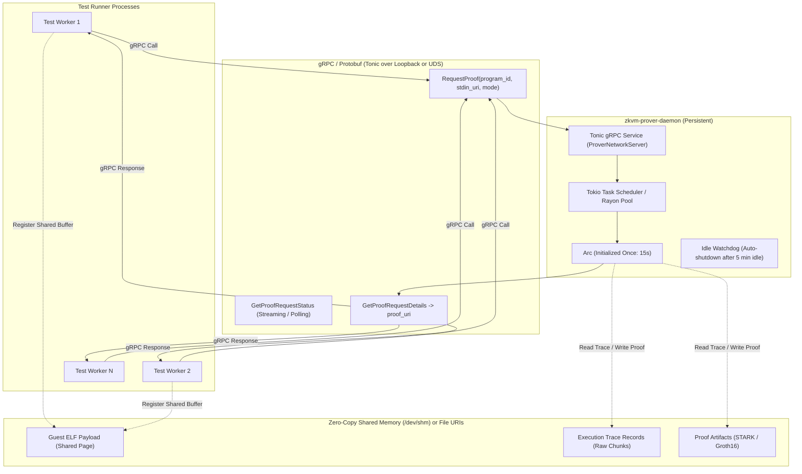
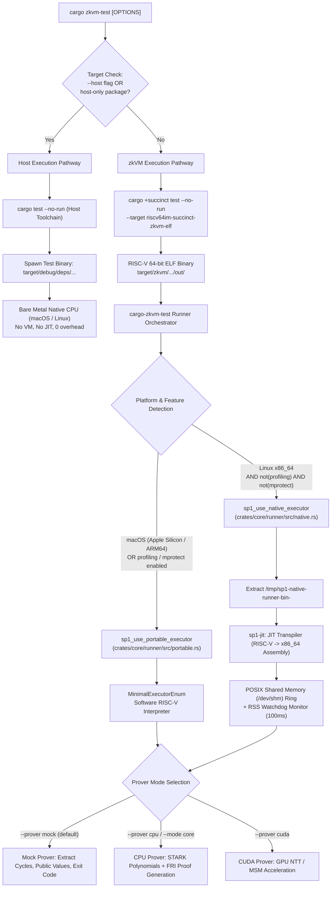

# Prover Daemon, Trace Mining, and High-Resolution Diagnostics in `zkvm-test`

This document outlines the architectural roadmap for three advanced capabilities in the `zkvm-test` ecosystem:
1. **The Shared-Memory Prover Daemon**: Amortizing expensive prover initialization across test suites.
2. **Execution Trace Mining**: Leveraging zero-copy trace records for code coverage, memory profiling, and cycle divergence analysis.
3. **High-Resolution Fault Diagnostics**: Inspecting hardware signals, memory addresses, and execution errors directly in test output.

---

## 1. The Prover Daemon Architecture

### The Problem: Prover Initialization Bottleneck
In SP1, creating a prover instance (`ProverClient::builder().cpu().build()` or `.cuda().build()`) is extremely expensive:
- Loading STARK machine constraint definitions.
- Initializing the recursion gnark-ffi runtime and Go bridge.
- Warming up CUDA contexts, allocating device memory pools, and compiling device kernels.
- Loading setup keys and precomputed lookup tables.

This startup sequence takes **10 to 20 seconds**. If a test suite contains 50 or 100 tests with proving enabled (`--mode core`, `--mode compressed`, or `--mode groth16`), creating a new `ProverClient` per test adds **15 to 30 minutes** of pure startup overhead.

```
Individual Test Prover Invocations (Current Naive Approach):
[Test 1] (Startup: 15s) -> [Prove: 2s]
[Test 2] (Startup: 15s) -> [Prove: 1s]
[Test 3] (Startup: 15s) -> [Prove: 3s]
... Total 100 tests = ~25 minutes of initialization delay
```

### The Solution: Background Prover Daemon

Instead of spinning up a `ProverClient` inside every test runner process, `cargo-zkvm-test` can coordinate with a persistent **Prover Daemon** (`zkvm-prover-daemon`) that initializes the prover machinery once and handles requests concurrently.

---

### Key Architectural Insight: Emulating the SP1 Network Prover Protocol

Rather than inventing a bespoke IPC protocol and wire format, we can align directly with SP1's upstream remote proving architecture: the **SP1 Network Prover** (`sp1_sdk::network::prover::NetworkProver` / `NetworkClient`).

#### How SP1 Network Prover Works Upstream
In the official SP1 SDK, remote proof generation is already abstracted:
- `ProverClient::builder().network().hosted().rpc_url("http://...").build()` creates a `NetworkProver`.
- Under the hood, `NetworkClient` communicates via **gRPC** (`tonic::transport::Channel`) with the `ProverNetwork` service (with REST/JSON fallback for artifact storage).
- The `.hosted()` mode (`NetworkMode::Reserved`) was specifically engineered for self-hosted prover clusters, skipping client-side simulation and delegating the entire proving pipeline to the server endpoint.

```
SP1 Upstream Protocol Surface:
├── ProverNetwork (gRPC / Tonic)
│   ├── CreateProgram(program_bytes) -> program_id
│   ├── RequestProof(program_id, stdin, mode) -> proof_request_id
│   ├── GetProofRequestStatus(proof_request_id) -> status (Pending, Running, Fulfilled, Failed)
│   └── GetProofRequestDetails(proof_request_id) -> proof bytes + public values
└── ArtifactStore (gRPC / HTTP)
    └── CreateArtifact(artifact_type, uri)
```

#### Why Emulating Network Prover is a Huge Strategic Win:
1. **Zero Bespoke Protocol Overhead**:
   - We avoid inventing, versioning, debugging, and maintaining a custom test-runner IPC wire protocol.
   - We reuse SP1's generated Protobuf schemas and `tonic` gRPC types directly.
2. **First-Class Upstream Ergonomics**:
   - Any test or user application written using standard SP1 SDK network client idioms (`ProverClient::builder().network().hosted().rpc_url("http://127.0.0.1:50051").build()`) works out of the box.
   - No custom test harness wrappers or proprietary APIs required.
3. **Frictionless Development to Production Continuum**:
   - **Local Iteration**: Point `SP1_PROVER_URL` to `http://127.0.0.1:50051` (local `zkvm-prover-daemon`). Proofs run locally on developer hardware with 0 initialization delay.
   - **CI / Cloud**: Point `SP1_PROVER_URL` to `https://rpc.succinct.xyz` with a network private key. Proofs run on the decentralized Succinct Prover Network.
   - **Zero code changes** between local testing and remote network execution.
4. **Transport Flexibility**:
   - Standard HTTP/2 over loopback TCP (`127.0.0.1:50051`) works universally on macOS and Linux.
   - For even lower latency on Unix systems, `tonic` can bind directly to a **Unix Domain Socket** (`~/.zkvm/prover.sock`) using hyper's incoming stream adapter.

---

### Hybrid Transport: gRPC Control Plane + Shared Memory Data Plane

For maximum efficiency, the prover daemon can implement a hybrid architecture:



1. **Control Plane (gRPC via Tonic)**:
   - Manages lifecycle, job queues, cancellations, and status polling/streaming.
   - Implements standard `ProverNetwork` RPC methods.
2. **Data Plane (Shared Memory / Filesystem URIs)**:
   - If the client and daemon detect they are running on the same machine, input payloads (`SP1Stdin`, large ELFs) and output artifacts (STARK proof, execution traces) can be passed by reference via `/dev/shm` handles or local file paths (`file://...` or `shm://...`).
   - If running remotely or in non-shared containers, standard gRPC byte chunk streaming is used as a transparent fallback.
3. **Daemon Lifecycle & Idle Reclamation**:
   - `cargo zkvm-test` probes the local RPC endpoint (`http://127.0.0.1:50051` or `~/.zkvm/prover.sock`).
   - If not running, it automatically spawns `zkvm-prover-daemon` in the background, waits for readiness, and begins dispatching test jobs.
   - An inactivity watchdog in the daemon shuts the process down after an idle window (e.g. 5 minutes) to release CPU, RAM, and GPU/VRAM resources.

---

## 2. Trace Data Mining: Unlocking Engine-Level Insights

During execution, the SP1 executor generates detailed execution trace records (`TraceChunkRaw`). In mock testing, generating full STARK proofs is skipped, but the raw trace data represents a rich, untapped source of testing intelligence.

### A. Line-by-Line In-VM Code Coverage
Unlike host Rust code which uses `llvm-cov` source instrumentation, instrumenting guest zkVM binaries inflates cycle counts and alters register allocation.
- **The Trace Opportunity**: The execution trace contains the exact sequence of all Program Counters (PCs) executed by the RISC-V CPU.
- **Implementation**:
  1. During test execution, collect the set of executed instruction addresses $\{ \text{PC}_0, \text{PC}_1, \dots \}$.
  2. Parse the DWARF `.debug_line` section from the guest ELF.
  3. Map executed addresses to source file lines and function branches.
  4. Emit standard `lcov.info` files for integration with coverage dashboards (Codecov, GitHub Actions).
  5. **Result**: True, zero-overhead in-VM code coverage without modifying guest code.

### B. Accurate Memory Profiling & Leak Detection
- **The Trace Opportunity**: Every memory access event records the target address, operation (`Read` vs `Write`), and timestamp.
- **Implementation**:
  - Compute the precise high-water mark of guest memory allocation.
  - Detect uninitialized memory reads (reading an unmapped page or unwritten memory word).
  - Surface stack growth vs heap growth breakdowns in test reports.

### C. Cycle Divergence Debugging
- **The Problem**: When refactoring guest code or optimizing an algorithm, subtle logic changes may cause the cycle count to regress or outputs to mismatch.
- **The Trace Opportunity**:
  - Record the trace of the baseline execution and the candidate execution.
  - Run a streaming diff over trace chunks.
  - Pinpoint the exact instruction where execution diverged:
    ```
    [DIVERGENCE DETECTED]
    Execution diverged at cycle 1,420,892:
      Baseline: PC 0x80001048 (BEQ x10, x11, +12) -> Branch Taken (Jump to 0x80001054)
      Current:  PC 0x80001048 (BEQ x10, x11, +12) -> Branch Not Taken (Fallthrough to 0x8000104c)
      Trigger: Register x10 held 0x00000000 (Baseline) vs 0x00000001 (Current)
      Source: crates/sha256/src/lib.rs:142
    ```

---

## 3. High-Resolution Fault Diagnostics

### Current Implementation in `zkvm-test-runner`
We updated `crates/zkvm-test-runner/src/runner.rs` to inspect `sp1_core_executor::ExecutionError` variants and produce structured diagnostic output:

| Error Variant | Formatted Diagnostic Output |
| :--- | :--- |
| `InvalidMemoryAccess(op, addr)` | `memory fault: invalid memory access for opcode {op:?} at address 0x{addr:08x}` |
| `InvalidMemoryAccessUntrustedProgram(addr)` | `alignment fault: unaligned instruction fetch at address 0x{addr:08x} (must be 4-byte aligned)` |
| `UnsupportedSyscall(num)` | `syscall fault: unimplemented syscall 0x{num:08x} ({num})` |
| `Breakpoint()` | `breakpoint encountered (ebreak)` |
| `ExceededCycleLimit(limit)` | `cycle limit exceeded: program exceeded configured limit of {limit} cycles` |
| `InvalidSyscallUsage(addr)` | `syscall error: syscall invoked in unconstrained mode at address 0x{addr:08x}` |
| `Unimplemented()` | `illegal instruction: encountered unimplemented opcode (unimp)` |
| `EndInUnconstrained()` | `unconstrained mode error: program halted while still in unconstrained execution block` |
| `TooMuchMemory()` | `memory budget exceeded: guest program exceeded configured in-VM memory allocation` |
| `KilledByMemoryMonitor(mb)` | `memory limit exceeded: child executor killed by watchdog monitor (measured {mb} MB)` |
| `ChildKilled()` | `child executor killed externally (possible OS / cgroup OOM-killer)` |

### Future Hardware Signal Interception (JIT on Linux)
On x86_64 Linux platforms running native JIT:
- The runner binary catches `SIGSEGV` using `crash_handler` and extracts POSIX `siginfo`:
  - `SEGV_MAPERR`: Read from an unmapped page.
  - `SEGV_ACCERR`: Write to a read-only page or guard page.
- We can pipe these hardware fault codes directly to the test failure message, detailing whether the guest attempted an illegal read or illegal write.

---

## 4. Execution Decision Matrix

The following chart outlines the exact execution pathways taken from `cargo zkvm-test` down to the hardware:



---

## 5. Summary & Next Steps

1. **High-Resolution Diagnostics (Shipped)**:
   - Added `format_execution_error` in `crates/zkvm-test-runner/src/runner.rs`.
   - Verified via unit test `test_format_execution_error` and deployed via `make install`.
2. **Prover Daemon (Roadmap)**:
   - Align daemon interface with SP1's `NetworkProver` / `ProverNetwork` gRPC service.
   - Support `ProverClient::builder().network().hosted().rpc_url(...)` out of the box.
   - Implement hybrid data plane: gRPC control plane with zero-copy `/dev/shm` payload passing for local workers.
3. **Trace Mining (Roadmap)**:
   - Investigate pulling executed PC vectors from `TraceChunkRaw`.
   - Build a prototype coverage mapper converting guest PCs to DWARF source line hit counts.
