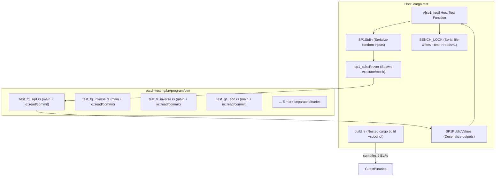
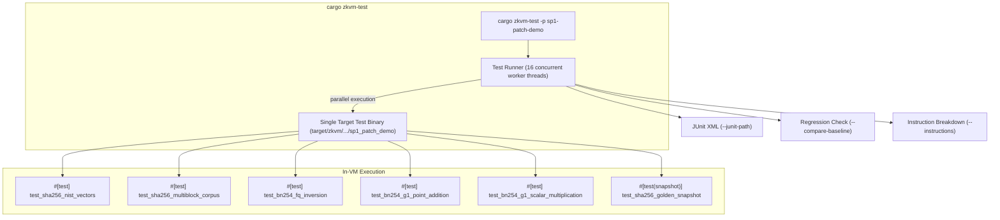

# Case Study: Modernizing SP1 Patch Testing with `cargo zkvm-test`

This case study compares the current test architecture in the upstream SP1 repository ([`succinctlabs/sp1/patch-testing`](file:///Users/tcrypt/code/github.com/succinctlabs/sp1/patch-testing)) against the modernized, in-VM test architecture provided by `cargo-zkvm-test` using the [`crates/sp1-patch-demo`](file:///Users/tcrypt/code/github.com/tcrypt25519/bitcoin-header-chain/crates/sp1-patch-demo) showcase.

---

## 1. Executive Summary

SP1 maintains patched cryptographic libraries (`substrate-bn`, `sha2`, `k256`, `curve25519-dalek`, `secp256k1`, etc.) to accelerate zero-knowledge execution with specialized RISC-V precompile syscalls (`BN254_FP_MUL`, `SHA_COMPRESS`, `SHA_EXTEND`, etc.).

Testing these patches in upstream SP1 currently requires an extraordinary amount of scaffolding:
- **Dozens of standalone guest binaries**: Each test case requires its own `#![no_main]` binary in a separate guest crate.
- **Fragile recursive build scripts**: Host `build.rs` scripts invoke nested `cargo build +succinct` sub-processes into isolated `target/elf-compilation` folders with complex environment scrubbing.
- **Bespoke test drivers**: A custom procedural macro (`#[sp1_test]`) spins up host-side provers, pipes inputs through `SP1Stdin`, and checks equality on serialized `SP1PublicValues`.
- **Serial CI execution**: Cycle benchmarks require an in-memory lock (`BENCH_LOCK`), forcing CI to run with `--test-threads=1`, followed by a separate binary (`compare-results`) to detect regressions.

With `cargo zkvm-test`, all of this overhead collapses into standard Rust `#[test]` functions running directly inside the zkVM.

---

## 2. Architecture Comparison

### Current SP1 Architecture


### With `cargo zkvm-test`


---

## 3. Side-by-Side Code Comparison

### Testing BN254 Field Inversion ($x \cdot x^{-1} \equiv 1$)

#### Before (SP1 Upstream Setup)
Requires **3 files across 2 packages**:

1. **Guest Binary** (`patch-testing/bn/program/bin/test_fq_inverse.rs`):
```rust
#![no_main]
sp1_zkvm::entrypoint!(main);

pub fn main() {
    let times = sp1_lib::io::read::<u8>();
    for _ in 0..times {
        let val: Vec<u8> = sp1_lib::io::read();
        let val = substrate_bn::Fq::from_slice(&val).unwrap();
        let inverse = val.inverse().unwrap();
        let mut inverse_bytes = [0u8; 32];
        inverse.to_big_endian(&mut inverse_bytes).unwrap();
        sp1_lib::io::commit(&inverse_bytes.to_vec());
    }
}
```

2. **Host Test Driver** (`patch-testing/bn/src/lib.rs`):
```rust
#[sp1_test::sp1_test("bn_test_fq_inverse", syscalls = [BN254_FP_MUL], gpu, prove)]
pub fn test_bn_test_fq_inverse_100(
    stdin: &mut sp1_sdk::SP1Stdin,
) -> impl FnOnce(sp1_sdk::SP1PublicValues) {
    use substrate_bn::Fq;
    let times: u8 = 100;
    stdin.write(&times);
    let mut unpatched_results: Vec<Vec<u8>> = Vec::new();
    while unpatched_results.len() < times as usize {
        let rand_bytes = rand::random::<[u8; 32]>();
        let rand = match Fq::from_slice(&rand_bytes) {
            Ok(rand) => rand,
            Err(_) => continue,
        };
        let mut inverse_bytes = [0u8; 32];
        match rand.inverse() {
            Some(inverse) => inverse.to_big_endian(&mut inverse_bytes).unwrap(),
            None => continue,
        };
        stdin.write(&rand_bytes.to_vec());
        unpatched_results.push(inverse_bytes.to_vec());
    }
    |mut public| {
        for res in unpatched_results {
            let zk_res = public.read::<Vec<u8>>();
            assert_eq!(res, zk_res);
        }
    }
}
```

3. **Build Script & Manifests**:
   - `build.rs` spawning nested cargo build
   - `patch-testing/Cargo.toml` manually excluding `bn/program` from the workspace.

#### After (`cargo zkvm-test`)
Requires **only standard in-crate unit tests** (`crates/sp1-patch-demo/src/lib.rs`):
```rust
#[test]
fn test_bn254_fq_inversion() {
    for seed in 1..=10u64 {
        let mut bytes = [0u8; 32];
        bytes[24..32].copy_from_slice(&seed.to_be_bytes());
        if let Ok(val) = Fq::from_slice(&bytes) {
            if let Some(inv) = val.inverse() {
                assert_eq!(val * inv, Fq::one());
            }
        }
    }
}
```

- **Lines of code**: ~65 lines across 3 files $\rightarrow$ **12 lines in 1 file** (81% reduction).
- **Zero build scripts**: No nested `cargo build` in `build.rs`.
- **Zero host/guest IPC overhead**: No `SP1Stdin`, no `SP1PublicValues`, no byte serialization.
- **Direct assertion failures**: Panics pinpoint exact line numbers with `left == right` diffs instead of opaque exit codes.

---

## 4. Benchmark & Metrics Comparison

Running `cargo zkvm-test -p sp1-patch-demo` executes 8 cryptographic unit tests in the zkVM:

```
$ cargo zkvm-test -p sp1-patch-demo

running 8 tests (prover: mock, threads: 16)
test sp1_patch_demo::tests::test_sha256_golden_snapshot ... ok (126,209 cycles, trace: 35.63 MB)
test sp1_patch_demo::tests::test_sha256_nist_vectors ... ok (230,149 cycles, trace: 64.97 MB)
test sp1_patch_demo::tests::test_sha256_multiblock_corpus ... ok (665,785 cycles, trace: 187.94 MB)
test sp1_patch_demo::tests::test_sha256_chained_iterations ... ok (1,596,828 cycles, trace: 450.76 MB)
test sp1_patch_demo::tests::test_bn254_fq_inversion ... ok (7,251,348 cycles, trace: 2.00 GB)
test sp1_patch_demo::tests::test_bn254_fr_inversion ... ok (11,436,340 cycles, trace: 3.15 GB)
test sp1_patch_demo::tests::test_bn254_g1_point_addition_and_doubling ... ok (12,280,660 cycles, trace: 3.39 GB)
test sp1_patch_demo::tests::test_bn254_g1_scalar_multiplication ... ok (22,550,473 cycles, trace: 6.22 GB)

test result: ok. 8 passed; 0 failed; 0 ignored; 0 measured; 0 filtered out; finished in 0.67s (total cycles: 56,137,792, peak host rss: 650.2 MB)
```

### Key Performance Highlights:
- **56,137,792 total cycles executed in 0.67 seconds** across 16 parallel threads.
- In SP1's upstream setup, running each test requires spinning up a separate ELF prover sequentially due to the `BENCH_LOCK` benchmark lock.

### Built-In Instruction Breakdown (`--instructions` / `--opcodes`):
```
$ cargo zkvm-test -p sp1-patch-demo -E 'test(bn254_g1_point_addition)' --instructions

test sp1_patch_demo::tests::test_bn254_g1_point_addition_and_doubling ... ok (12,280,660 cycles, trace: 3.39 GB)
    Instruction Categories:
        ├── ALU (arithmetic/logic)   :  3,635,760 instructions ( 29.6%)
        ├── Memory (load/store)      :  6,543,701 instructions ( 53.3%)
        ├── Control (branch/jump)    :  2,099,398 instructions ( 17.1%)
        ├── Math (mul/div/rem)       :      1,782 instructions (  0.0%)
        └── System (ecall/trap)      :         19 instructions (  0.0%)
```

### Native CI Regression Testing (`--compare-baseline`):
```
$ cargo zkvm-test -p sp1-patch-demo --compare-baseline v1

Baseline comparison against 'v1':
Test Name                                                          Baseline        Current         Change
----------------------------------------------------------------------------------------------------------
sp1_patch_demo::tests::test_bn254_fq_inversion                    7,251,348      7,251,348           0.0%
sp1_patch_demo::tests::test_bn254_fr_inversion                   11,436,340     11,436,340           0.0%
sp1_patch_demo::tests::test_bn254_g1_point_addition_and_doubling     12,280,660     12,280,660           0.0%
sp1_patch_demo::tests::test_bn254_g1_scalar_multiplication       22,550,473     22,550,473           0.0%
sp1_patch_demo::tests::test_sha256_chained_iterations             1,596,828      1,596,828           0.0%
sp1_patch_demo::tests::test_sha256_golden_snapshot                  126,209        126,209           0.0%
sp1_patch_demo::tests::test_sha256_multiblock_corpus                665,785        665,785           0.0%
sp1_patch_demo::tests::test_sha256_nist_vectors                     230,149        230,149           0.0%
----------------------------------------------------------------------------------------------------------
```

### Dual Target Execution (`--all-targets`):
Tests execute identically on the host native CPU and in the zkVM:
```
$ cargo zkvm-test -p sp1-patch-demo --all-targets

cargo-zkvm-test: testing 1 zkVM package: sp1-patch-demo
cargo-zkvm-test: testing 1 host package: sp1-patch-demo

Running host tests for `sp1_patch_demo`: 8 passed (0.00s)
Running zkVM tests for `sp1_patch_demo`: 8 passed (0.69s)
```

---

## 5. Summary of Benefits for Upstream SP1

| Feature / Metric | SP1 Current Setup | With `cargo zkvm-test` |
| :--- | :--- | :--- |
| **Test Definition** | Custom `#[sp1_test]` proc macro + host driver + guest `main()` binary | Standard idiomatic `#[test]` attribute |
| **Artifact Count** | 9+ standalone binary files per patch crate | 1 single library / test binary |
| **Workspace Setup** | Must add all `*/program` directories to `exclude = [...]` | Standard Cargo workspace member |
| **Build Mechanism** | Recursive `cargo build` in `build.rs` with fragile env scrubbing | Direct compilation to `target/zkvm` |
| **Concurrency** | Forced `--test-threads=1` due to file locking (`BENCH_LOCK`) | Fully parallel execution (16+ concurrent threads) |
| **Diagnostics** | Opaque exit codes or raw panic strings | Precise `left == right` assertion diffs with line numbers |
| **Profiling & Metrics** | Custom JSON dump scripts + standalone `compare-results` tool | Built-in `--instructions`, `--profile`, and `--compare-baseline` |
| **CI Integration** | Custom workflow scripts | Standard `--junit-path` XML export |
